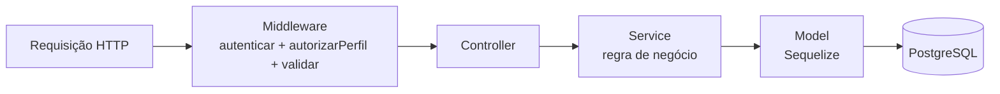

# Ocorrência+ — Apresentação do Backend

> Guia pra navegar no código e mostrar pra turma. Leitura de ~10-15 min; pensado pra abrir os arquivos citados enquanto fala. Organizado por **eixo** (tipo de arquivo), não por ordem cronológica — cada eixo é uma "fatia" que atravessa o projeto inteiro.

## 1. O que é o projeto (1 min)

**Ocorrência+** substitui os cadernos físicos que a coordenação usa pra registrar ocorrências disciplinares e de destaque dos alunos. A frase que resume o escopo todo (está em `specs/Requirements.md` §1):

> "O Ocorrência+ existe para **REGISTRAR OCORRÊNCIAS**."

Três perfis usam o sistema: **coordenador** (acesso total), **professor** (só nas turmas em que leciona) e **aluno** (só o próprio histórico).

## 2. Como o projeto foi planejado antes de ter uma linha de código (1 min)

Antes de programar, a ideia virou três documentos, em ordem — é a metodologia **Spec-Driven Development**:

```
Requirements.md  →  O QUÊ precisa existir (requisitos, regras de negócio)
Design.md        →  COMO vai ser feito (rotas, modelos, decisões técnicas)
Task.md          →  EM QUE ORDEM implementar (tarefas numeradas, 1.1, 1.2, ...)
```

Cada rota da API já estava desenhada — método, perfis permitidos, formato de erro — antes de existir código pra ela. Vale abrir `specs/Design.md` e mostrar a tabela de rotas (R01 a R19): é o índice de tudo que foi construído.

## 3. O mapa: toda requisição passa pelos mesmos eixos, nessa ordem (2 min)

Abra `src/routes/ocorrencias.routes.js` e mostre essa linha — ela sozinha já contém 3 dos 4 eixos que vêm a seguir:

```js
router.post('/', autorizarPerfil('professor', 'coordenador'), validar(esquemaRegistro), ocorrenciaController.registrar);
```



| Eixo | Pergunta que responde | Pasta |
| --- | --- | --- |
| **Middlewares** | Quem é você, pode estar aqui, os dados estão certos? | `src/middlewares/` |
| **Controllers** | Que resposta HTTP devolver? | `src/controllers/` |
| **Services** | Qual é a regra de negócio de verdade? | `src/services/` |
| **Models** | Como isso vira linha de tabela no banco? | `src/models/` |

A ideia central, o princípio de **separação de responsabilidades**: cada eixo só sabe fazer uma coisa. O controller nunca consulta o banco direto; o service nunca sabe o que é "status 403" (isso é HTTP, não regra de negócio). As próximas 4 seções percorrem o projeto inteiro **por eixo** — abrindo vários arquivos de pastas diferentes que fazem o mesmo tipo de trabalho.

## 4. Eixo — Middlewares: tudo que decide "você pode seguir?" (4 min)

Três middlewares, três perguntas diferentes, sempre nessa ordem numa rota protegida:

**a) Autenticação — "quem é você?"** (`middlewares/autenticar.js` + `controllers/auth.controller.js`)

```js
// auth.controller.js — login
const senhaOk = usuario && (await bcrypt.compare(senha, usuario.senhaHash));
if (!senhaOk) throw new ErroApp(401, 'CREDENCIAIS_INVALIDAS', 'Matrícula ou senha inválidos.');

const token = jwt.sign({ perfil: usuario.perfil }, process.env.JWT_SECRET, {
  subject: usuario.id,
  expiresIn: process.env.JWT_EXPIRES_IN,
});
```

```js
// middlewares/autenticar.js — toda rota protegida
const { sub, perfil } = jwt.verify(token, process.env.JWT_SECRET);
req.usuario = { id: sub, perfil };
```

**bcrypt** guarda só o hash da senha (nunca texto puro); `compare()` testa sem nunca "descriptografar" nada. **JWT** é a identidade que o cliente carrega — o servidor não guarda sessão, só confere a assinatura. É por isso que a API é **stateless**. Vale abrir um token em [jwt.io](https://jwt.io): o conteúdo é só codificado, não criptografado — **nunca** vai senha no payload.

**b) Autorização por perfil — "esse perfil pode estar aqui?"** (`middlewares/autorizarPerfil.js`)

```js
export default function autorizarPerfil(...perfis) {
  return (req, res, next) =>
    perfis.includes(req.usuario.perfil) ? next() : next(new ErroApp(403, 'ACESSO_NEGADO', 'Acesso negado.'));
}
```

Uma função que recebe perfis e devolve um middleware — é por isso que a rota lê `autorizarPerfil('coordenador')` como se fosse uma frase.

**c) Validação de entrada — "os dados estão no formato certo?"** (`middlewares/validar.js` + `validators/*.validator.js`)

```js
const { error, value } = esquema.validate(req[origem], { abortEarly: false, stripUnknown: true });
if (error) return next(new ErroApp(400, 'VALIDACAO', 'Dados inválidos.', detalhes));
```

Os esquemas (**Joi**) ficam em `validators/` — um por recurso (`ocorrencia.validator.js`, `aluno.validator.js`...). `stripUnknown: true` é o detalhe que garante que um campo estranho enviado no corpo (ex.: alguém tentando mandar `criadoPor` manualmente) é descartado antes de chegar em qualquer lugar perigoso.

Hoje tem um quarto guardião só na rota de login: `express-rate-limit` (`routes/auth.routes.js`), que bloqueia depois de muitas tentativas de senha errada — defesa contra força bruta.

## 5. Eixo — Models: as regras que o próprio banco de dados garante (3 min)

`src/models/` tem um arquivo por tabela, e `models/index.js` declara como elas se relacionam:

```js
Aluno.hasMany(Ocorrencia, { foreignKey: 'alunoId', as: 'ocorrencias' });
Ocorrencia.belongsTo(Turma, { foreignKey: 'turmaId', as: 'turma' });
```

Isso é **ORM** (Sequelize): cada tabela do PostgreSQL vira uma classe JavaScript, e as relações (`hasMany`, `belongsTo`) deixam o código ler quase como português, sem escrever `JOIN` na mão.

O modelo mais importante é `models/Ocorrencia.js`, porque guarda uma regra de negócio crítica: **uma ocorrência nunca é editada ou excluída**, só arquivada.

```js
Ocorrencia.beforeUpdate((ocorrencia) => {
  const alterados = ocorrencia.changed().filter((campo) => !CAMPOS_ARQUIVAMENTO.includes(campo));
  if (alterados.length > 0) throw new Error('OCORRENCIA_IMUTAVEL');
});

Ocorrencia.beforeDestroy(() => {
  throw new Error('OCORRENCIA_NAO_PODE_SER_EXCLUIDA');
});
```

São **hooks** — funções que o Sequelize roda automaticamente antes de uma operação no banco. Mesmo que um código novo, no futuro, tentasse mudar uma ocorrência de outro jeito, o próprio modelo recusa. É a diferença entre uma regra "documentada" e uma regra "garantida no código".

Outro detalhe de modelo que vale mostrar: `ocorrencias.turma_id` guarda a turma do aluno **no momento do registro**, não a turma atual — se o aluno for transferido depois, a ocorrência antiga continua "lembrando" a turma de origem (decisão de design, RN5, testada de ponta a ponta na Tarefa 1.8).

## 6. Eixo — Controllers: a tradução entre HTTP e regra de negócio (2 min)

Compare `controllers/auth.controller.js` com `controllers/ocorrencia.controller.js` — o padrão se repete em todos:

```js
export async function registrar(req, res) {
  const ocorrencia = await ocorrenciaService.registrar(req.usuario, req.body);
  res.status(201).json(serializarOcorrencia(ocorrencia));
}
```

Um controller **nunca** decide regra de negócio — ele só faz três coisas: (1) pega dados da requisição (`req.body`, `req.params`, `req.usuario`), (2) chama o service, (3) devolve a resposta HTTP (status + JSON). Toda a decisão real ("esse professor pode fazer isso?", "essa ocorrência existe?") está no service — o controller, de propósito, é "burro".

Um detalhe que vale destacar em `ocorrencia.controller.js`: existe uma função `serializarOcorrencia()` (formata o JSON de resposta) reaproveitada por `registrar`, `listar`, `detalhar` e `arquivar` — quatro rotas diferentes, uma função só decidindo "como uma ocorrência aparece pra fora". Evita que o formato da resposta fique inconsistente entre rotas.

## 7. Eixo — Services: onde a regra de negócio de verdade mora (2 min)

`services/escopo.service.js` é o melhor exemplo porque é consultado por quase toda rota de ocorrências e alunos:

```js
export async function turmasPermitidas(usuario) {
  if (usuario.perfil === 'coordenador' || usuario.perfil === 'apoio_pedagogico') return null; // todas
  if (usuario.perfil === 'professor') {
    const vinculos = await ProfessorTurma.findAll({ where: { professorId: usuario.id } });
    return vinculos.map((v) => v.turmaId); // só as vinculadas
  }
  return []; // aluno: nenhuma
}
```

Um professor só registra, lista, arquiva ou consulta dentro das turmas em que está de fato vinculado — comprovado na Tarefa 1.8 (`history/20261116_cadastros_transferencia_tarefa_1.8.md`): criamos uma turma nova, um professor sem vínculo recebeu `403`, e o mesmo professor, depois de vinculado, conseguiu registrar imediatamente.

## 8. Fora dos 4 eixos: os testes automatizados (2 min)

Até a Tarefa 1.8, todo teste era manual (`curl`/Postman). A Tarefa 1.9 transformou 5 "propriedades de corretude" do projeto em testes que rodam com um comando:

```bash
npm test
# Test Suites: 6 passed, 6 total
# Tests:       17 passed, 17 total
```

Um exemplo, `tests/p1-imutabilidade.test.js`, testando a regra da seção 5 **por fora** da API (direto no modelo):

```js
it('instancia.update() fora da API lança OCORRENCIA_IMUTAVEL', async () => {
  const ocorrencia = await Ocorrencia.findByPk(ocorrenciaId);
  await expect(ocorrencia.update({ descricao: 'alterado direto no modelo' })).rejects.toThrow('OCORRENCIA_IMUTAVEL');
});
```

A diferença entre testar na mão e um teste automatizado: esse arquivo roda de novo, sempre, em segundos, toda vez que alguém mudar o código — sem testes, ninguém notaria se uma mudança futura quebrasse essa regra.

## 9. O histórico de como chegamos até aqui (1 min)

Cada tarefa concluída tem uma entrada em `history/` — um diário de desenvolvimento, incluindo os bugs reais encontrados no caminho (vale abrir um ou dois pra mostrar):

| Tarefa | Entrada | O que resolveu |
| --- | --- | --- |
| 1.1 | `20261026_rotas_simuladas_tarefa_1.1.md` | Rotas do núcleo com respostas simuladas, antes de existir banco |
| 1.2 | `20261104_seeders_tarefa_1.2.md` | PostgreSQL + Sequelize: modelos, migrations, dados de desenvolvimento |
| 1.3 | `20261104_autenticacao_tarefa_1.3.md` | Login real com JWT + bcrypt, rate limit contra força bruta |
| 1.4 | `20261109_registrar_ocorrencia_tarefa_1.4.md` | Registrar de verdade — e dois bugs reais: Express 5 x `req.query`, fuso horário na data |
| 1.5 | `20261109_listar_detalhar_tarefa_1.5.md` | Listar/filtrar/paginar |
| 1.6 | `20261116_arquivar_ocorrencia_tarefa_1.6.md` | Arquivar com motivo; bloqueio de edição/exclusão |
| 1.7 | `20261116_historico_aluno_apoio_tarefa_1.7.md` | Histórico do aluno, visão do aluno, leituras de apoio |
| 1.8 | `20261116_cadastros_transferencia_tarefa_1.8.md` | Cadastros + teste de ponta a ponta da regra RN5 |
| 1.9 | `20261116_testes_automatizados_tarefa_1.9.md` | Suíte automatizada (Jest + Supertest) |
| 1.10 | `20261116_checkpoint_backend_tarefa_1.10.md` | Checkpoint final — fecha a Fase 1 |

## 10. O que leva pra casa (1 min)

Pra quem está aprendendo arquitetura e programação web, os conceitos que esse projeto exercita de verdade, não só na teoria:

- **Separar eixos** (middleware → controller → service → model) deixa cada parte testável e substituível isoladamente.
- **Autenticação ≠ autorização**: "quem é você" (JWT) é uma pergunta diferente de "você pode fazer isso" (perfil + escopo).
- **Controller burro, service inteligente**: a mesma função de formatação de resposta é reaproveitada em 4 rotas diferentes.
- **Regra de negócio crítica pertence ao código**, não só à documentação — os hooks do Sequelize são a prova.
- **Testes automatizados** existem pra não depender da memória de ninguém sobre "testei isso na semana passada".
- **Planejar antes de programar** (specs) evita descobrir, no meio do caminho, que faltou pensar numa regra importante.

## Próximo passo

Com a Fase 1 (núcleo do backend) encerrada, o projeto entra na Fase 2 — construir a interface (React) que consome essa mesma API.
