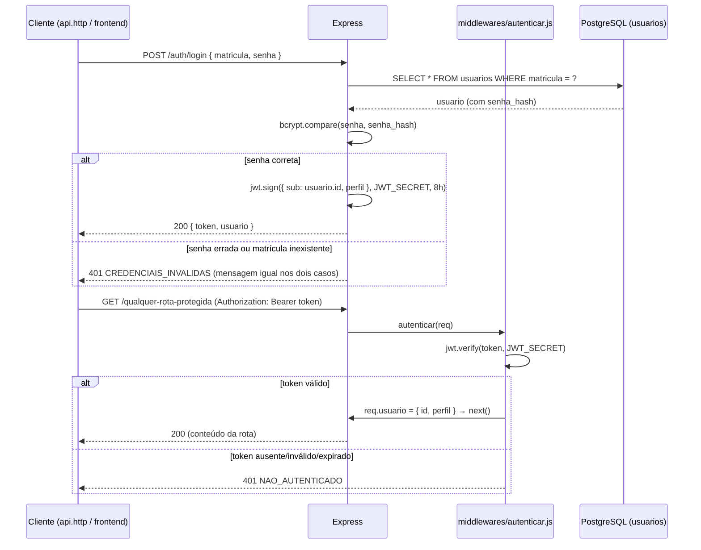

# Diário de desenvolvimento — 04/11/2026

# Tarefa 1.3 — Autenticação real e middlewares

## Objetivo

Até aqui (Tarefa 1.1), `POST /api/auth/login` e `GET /api/auth/me` só devolviam dados fixos — qualquer matrícula e senha "logavam" como o mesmo coordenador fictício, e nenhuma rota pedia token de verdade. A Tarefa 1.3 troca isso pela autenticação real (R02, R03): login com a senha de fato guardada no banco, geração de um token JWT, e uma camada que passa a exigir esse token em toda rota do núcleo — mesmo nas que ainda vão continuar devolvendo dados simulados até as Tarefas 1.4 a 1.8.

Esse arquivo documenta **o método de autenticação como um todo**: as peças, por que cada uma existe e como elas se encaixam — para servir de referência sempre que surgir dúvida sobre "como o login funciona" no projeto.

## Visão geral do método



Duas ideias centrais sustentam esse desenho:

1. **A senha nunca é guardada em texto puro, e nunca volta em nenhuma resposta.** O banco guarda só `senha_hash` (gerado com `bcrypt`, que inclui o *salt* dentro do próprio hash). Login compara a senha recebida com esse hash via `bcrypt.compare` — nunca descriptografando nada, porque hash não é reversível.
2. **O token é a "carteira de identidade" de cada requisição.** Depois do login, o cliente guarda o token e o envia em todo pedido (`Authorization: Bearer <token>`). O servidor não guarda sessão nenhuma — ele só confere a assinatura do token (com `JWT_SECRET`) e lê quem é o usuário e qual o perfil de dentro dele. É por isso que a API funciona "sem estado": qualquer instância do servidor consegue validar o token sozinha, sem perguntar a nenhum banco de sessões.

## As peças, uma a uma

### 1. `bcrypt` — proteger a senha guardada

`backend/src/controllers/auth.controller.js` usa `bcrypt.compare(senha, usuario.senhaHash)`. O hash já foi gerado pelos seeders (Tarefa 1.2) com `bcrypt.hash('senha123', 10)` — o `10` é o *custo* do algoritmo (quanto maior, mais lento e mais resistente a força bruta; 10 é um valor padrão razoável para este projeto).

### 2. JWT (`jsonwebtoken`) — provar quem é o usuário sem guardar sessão

Ao logar com sucesso, o servidor assina um token:

```js
jwt.sign({ perfil: usuario.perfil }, process.env.JWT_SECRET, {
  subject: usuario.id,
  expiresIn: process.env.JWT_EXPIRES_IN, // "8h"
});
```

O token carrega três informações relevantes no seu *payload*: `sub` (o id do usuário, campo padrão do JWT para "assunto"), `perfil` (para não precisar consultar o banco a cada requisição só para saber o perfil) e a expiração (`exp`, calculada a partir de `expiresIn`). Ele é assinado com `JWT_SECRET` (`.env`) — qualquer alteração no conteúdo do token invalida a assinatura, então um token não pode ser falsificado sem conhecer esse segredo.

**Importante:** o payload de um JWT não é criptografado, só assinado — qualquer um consegue decodificar e ler `sub`/`perfil` (ex.: em jwt.io). Por isso nunca colocamos a senha ou qualquer dado sensível no payload, só o id e o perfil, que não são segredos.

### 3. `middlewares/autenticar.js` — o "porteiro" de toda rota protegida

```js
const [esquema, token] = (req.headers.authorization || '').split(' ');
if (esquema !== 'Bearer' || !token) {
  return next(new ErroApp(401, 'NAO_AUTENTICADO', 'Faça login para continuar.'));
}
try {
  const { sub, perfil } = jwt.verify(token, process.env.JWT_SECRET);
  req.usuario = { id: sub, perfil };
  return next();
} catch {
  return next(new ErroApp(401, 'NAO_AUTENTICADO', 'Sessão inválida ou expirada.'));
}
```

`jwt.verify` faz duas coisas de uma vez: confere a assinatura (prova que o token não foi adulterado e foi emitido por este servidor) **e** confere a expiração (um token com `exp` no passado já falha aqui, sem precisar de nenhum código extra). Se passar, `req.usuario` fica disponível para todo o resto da requisição — é dali que toda rota futura vai saber "quem está pedindo isso e com que perfil".

### 4. `middlewares/autorizarPerfil.js` — o "zelador" de cada rota (ainda não usado)

```js
export default (...perfis) => (req, res, next) =>
  perfis.includes(req.usuario.perfil) ? next() : next(new ErroApp(403, 'ACESSO_NEGADO', ...));
```

Criado nesta tarefa porque o passo 3 do `Task.md` pede os três middlewares juntos, mas **ainda sem nenhuma rota usando ele** — ele só entra em ação a partir da Tarefa 1.4, quando `POST /api/ocorrencias` deixar de ser simulada e precisar recusar, por exemplo, um aluno tentando registrar uma ocorrência. A diferença para `autenticar`: `autenticar` responde "você é alguém conhecido?"; `autorizarPerfil` responde "você, com esse perfil, pode fazer *isso*?".

### 5. `middlewares/validar.js` — valida o formato do corpo antes de qualquer lógica

```js
const { error, value } = esquema.validate(req[origem], { abortEarly: false, stripUnknown: true });
```

Roda um esquema Joi (`abortEarly: false` para juntar **todos** os erros de uma vez, não só o primeiro) e, se inválido, devolve `400 VALIDACAO` já no formato único de erro do projeto (`codigo`, `mensagem`, `detalhes` por campo). Hoje só o login usa isso (`validators/auth.validator.js`: `matricula` e `senha` obrigatórias), mas o middleware é genérico — qualquer rota futura só precisa de um novo arquivo em `validators/`.

### 6. `express-rate-limit` — freio contra tentativa de adivinhar senha

```js
rateLimit({ windowMs: 15 * 60 * 1000, max: 10, handler: ... 429 MUITAS_TENTATIVAS ... })
```

Aplicado só em `POST /auth/login`. Conta tentativas por IP; depois de 10 em 15 minutos, todo pedido seguinte recebe `429` sem nem chegar a consultar o banco — essa é a defesa contra um script tentando senhas em sequência (*brute force*).

## Como as peças se encaixam nas rotas (`routes/index.js` e `routes/auth.routes.js`)

```
/api/health                    → público (R01)
/api/auth/login                → público, mas com rate limit (R02)
/api/auth/me                   → autenticar (R03)
──────────────── router.use(autenticar) a partir daqui ────────────────
/api/ocorrencias/...            → autenticar (R04-R08, ainda com dados simulados)
/api/alunos/:id/ocorrencias     → autenticar (R09, ainda simulada)
/api/me/ocorrencias             → autenticar (R10, ainda simulada)
```

A ideia de colocar `router.use(autenticar)` **depois** de montar `/auth` e **antes** de montar o resto é o que garante, numa linha só, que tudo que vem depois do login exige token — sem precisar repetir `autenticar` rota por rota.

## O que foi criado/alterado nesta tarefa

| Arquivo | Papel |
| --- | --- |
| `src/middlewares/autenticar.js` | valida o JWT, popula `req.usuario` |
| `src/middlewares/autorizarPerfil.js` | restringe por perfil (ainda sem uso) |
| `src/middlewares/validar.js` | valida corpo/query com Joi |
| `src/validators/auth.validator.js` | esquema do login |
| `src/controllers/auth.controller.js` | `login` e `me` de verdade |
| `src/routes/auth.routes.js` | `POST /login` (rate limit) e `GET /me` (protegida) |
| `src/routes/index.js` | reescrito para montar `/auth` e proteger tudo depois com `autenticar` |
| `api.http` | login nomeado (`@name login`) com `@token` capturado automaticamente da resposta; casos de senha errada, matrícula inexistente e requisições sem token |

**Dependência nova:** `jsonwebtoken` (pedido ao estudante instalar — convenção do projeto de passos de setup serem executados por ele).

## Como testar você mesmo

```bash
cd backend
npm install jsonwebtoken
npm run dev
```

Com o servidor no ar, abra `backend/api.http` (extensão REST Client do VS Code) e rode, nesta ordem:

1. **R02 - login real** → `200` com `token` e `usuario` (`matricula: "2026000001"`, `perfil: "coordenador"`, sem nenhum campo de senha).
2. **R02 - senha errada** e **R02 - matrícula inexistente** → ambas `401 CREDENCIAIS_INVALIDAS`, com a **mesma** mensagem (não dá pra um atacante descobrir se a matrícula existe só pela resposta).
3. **R03 - usuário autenticado** → usa o token do passo 1 automaticamente, devolve os dados do coordenador.
4. **R03 - sem token** → `401 NAO_AUTENTICADO`.
5. **R04 - sem token** → `401 NAO_AUTENTICADO`, mesmo a rota ainda sendo simulada.
6. **R04 - registrar ocorrência** (com token) → continua devolvendo a ocorrência de exemplo, mas só com token válido.

### Os mesmos testes em `curl` (sem precisar da extensão REST Client)

Com o servidor rodando (`npm run dev`) em outro terminal, rode cada bloco na ordem — o primeiro guarda o token numa variável de shell (`$TOKEN`) que os seguintes reaproveitam:

```bash
# 1. Login com a senha certa — deve devolver 200 com token e usuario
curl -s -X POST http://localhost:3333/api/auth/login \
  -H "Content-Type: application/json" \
  -d '{"matricula":"2026000001","senha":"senha123"}'
```

```bash
# 2. Guardar o token numa variável para os próximos testes
TOKEN=$(curl -s -X POST http://localhost:3333/api/auth/login \
  -H "Content-Type: application/json" \
  -d '{"matricula":"2026000001","senha":"senha123"}' \
  | node -pe 'JSON.parse(require("fs").readFileSync(0,"utf8")).token')
echo "Token: $TOKEN"
```

```bash
# 3. Senha errada — deve devolver 401 CREDENCIAIS_INVALIDAS
curl -s -o /dev/null -w "%{http_code}\n" -X POST http://localhost:3333/api/auth/login \
  -H "Content-Type: application/json" \
  -d '{"matricula":"2026000001","senha":"senha-errada"}'
curl -s -X POST http://localhost:3333/api/auth/login \
  -H "Content-Type: application/json" \
  -d '{"matricula":"2026000001","senha":"senha-errada"}'
```

```bash
# 4. Matrícula inexistente — deve devolver a MESMA mensagem 401 do teste 3
curl -s -X POST http://localhost:3333/api/auth/login \
  -H "Content-Type: application/json" \
  -d '{"matricula":"0000000000","senha":"senha123"}'
```

```bash
# 5. /auth/me com o token — deve devolver os dados do coordenador
curl -s http://localhost:3333/api/auth/me \
  -H "Authorization: Bearer $TOKEN"
```

```bash
# 6. /auth/me sem token — deve devolver 401 NAO_AUTENTICADO
curl -s http://localhost:3333/api/auth/me
```

```bash
# 7. /ocorrencias sem token — deve devolver 401, mesmo a rota ainda sendo simulada
curl -s -X POST http://localhost:3333/api/ocorrencias \
  -H "Content-Type: application/json" \
  -d '{"alunoId":"0f5c3b1e-8d7a-4f0a-9d7e-2a6c1b9e4a10","tipo":"atraso","gravidade":"leve","descricao":"teste","data":"2026-05-12"}'
```

```bash
# 8. /ocorrencias com token — 201 com a ocorrência simulada (negócio real só na Tarefa 1.4)
curl -s -X POST http://localhost:3333/api/ocorrencias \
  -H "Authorization: Bearer $TOKEN" \
  -H "Content-Type: application/json" \
  -d '{"alunoId":"0f5c3b1e-8d7a-4f0a-9d7e-2a6c1b9e4a10","tipo":"atraso","gravidade":"leve","descricao":"teste","data":"2026-05-12"}'
```

```bash
# 9. Rate limit — 10 tentativas de senha errada "estouram" na 11ª (429 MUITAS_TENTATIVAS)
for i in $(seq 1 11); do
  echo "Tentativa $i:"
  curl -s -o /dev/null -w "  status=%{http_code}\n" -X POST http://localhost:3333/api/auth/login \
    -H "Content-Type: application/json" \
    -d '{"matricula":"2026000001","senha":"senha-errada"}'
done
```

## O que observar

- O token colado em [jwt.io](https://jwt.io) deve mostrar `sub` = id do coordenador e `perfil: "coordenador"` no payload — e **nada** de senha em lugar nenhum (nem no token, nem em nenhuma resposta).
- 10 tentativas de login com senha errada em sequência devolvem `401`; a 11ª dentro de 15 minutos devolve `429 MUITAS_TENTATIVAS`.
- Qualquer rota a partir de `/ocorrencias`, `/alunos/:id/ocorrencias` ou `/me/ocorrencias` sem `Authorization: Bearer ...` devolve `401`, mesmo quando, com token, ela ainda responde dados fictícios.

## Decisões e pendências registradas

- `autorizarPerfil` foi criado mas fica sem uso até a Tarefa 1.4 — não há nenhuma rota real de negócio ainda para proteger por perfil.
- A pendência do `apoio_pedagogico` (ver `specs/Design.md` §8, item 5) continua aberta para quando `services/escopo.service.js` for criado: a função `turmasPermitidas` vai precisar tratar `apoio_pedagogico` como `coordenador` (`null` = todas as turmas), mas só leitura.

## Próximo passo

Confirmar os testes acima, marcar a Tarefa 1.3 como concluída em `specs/Task.md` e seguir para a Tarefa 1.4 — registrar ocorrência de verdade (a rota mais importante do projeto), onde `autorizarPerfil` e a lógica de escopo por turma finalmente entram em uso.
