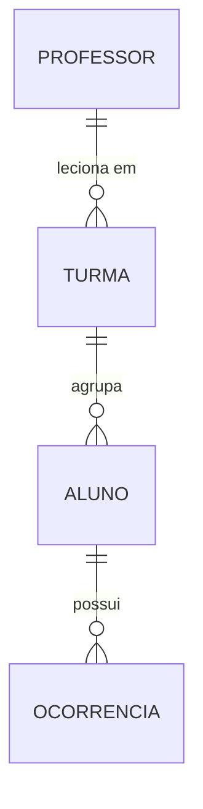
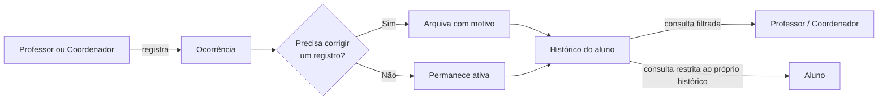

# Ocorrência Disciplinar — Módulo de Ocorrências

| **Autores** | Enzo e Lucas Rafael |
| **Versão** | 2.0 |
| **Data** | 09/10/2026 (versão inicial: 18/08/2026) |
| **Status** | Escopo revisado — foco exclusivo em Ocorrências |

---

## Nota de Escopo (v2.0)

A versão original deste briefing (v1.0) cobria dois módulos: **chamada/frequência** e **ocorrências disciplinares**. A pedido do professor orientador, esta revisão restringe o escopo do projeto exclusivamente ao módulo de **Ocorrências**. Chamada, presença e cálculo de frequência por aula deixam de fazer parte do sistema a ser construído nesta fase (ver "Fora de Escopo").

As entidades **Turma**, **Aluno** e o vínculo **Professor↔Turma** são mantidas: mesmo fora do escopo de chamada, elas continuam sendo pré-requisito para vincular corretamente uma ocorrência a um aluno e para restringir o acesso de cada professor às suas próprias turmas.

---

## Contexto

A coordenação escolar registra as ocorrências disciplinares e de destaque dos alunos em cadernos físicos. Cada professor ou coordenador anota à mão o que aconteceu, quando e com qual aluno — sem formato padronizado, sem busca e sem garantia de que o registro não será perdido, rasurado ou alterado posteriormente.

## Problema

É difícil consultar rapidamente o histórico disciplinar de um aluno, especialmente sob pressão: quando um responsável está em reunião pedindo explicações, folhear cadernos em busca de registros dispersos por data e por turma consome tempo e compromete a credibilidade da coordenação.

## Objetivo do Sistema

Substituir os cadernos de ocorrências por um sistema digital que permita **registrar, consultar e filtrar** ocorrências disciplinares e de destaque de forma rápida e confiável — com a garantia de que nenhum registro é perdido ou adulterado depois de criado.

---

## Atores

| Ator | Papel |
|---|---|
| **Professor** | Registra e consulta ocorrências dos alunos das turmas em que leciona |
| **Coordenador** | Registra, consulta e arquiva ocorrências de qualquer turma; cadastra turmas, alunos e vínculos de professor↔turma |
| **Aluno** | Consulta exclusivamente o próprio histórico de ocorrências |

## Entidades Principais

- **Turma** — agrupa alunos.
- **Aluno** — vinculado a uma turma.
- **Ocorrência** — registro individual vinculado a um aluno, com tipo, gravidade, descrição e data.

## Funcionalidades Macro

1. Cadastro de turmas e alunos
2. Vínculo de professores às turmas em que lecionam
3. Registro de ocorrências (aluno, tipo, gravidade, descrição, data)
4. Arquivamento de ocorrências (com motivo — nunca exclusão)
5. Listagem com filtro por aluno, turma, período, tipo e gravidade
6. Painel com indicadores de ocorrências por turma e alunos "em atenção"

## Fluxo Geral

---

## Regras de Negócio

1. Ocorrência registrada não é excluída — pode apenas ser arquivada com motivo, mantendo o histórico original visível.
2. Ocorrência não pode ser editada após o registro; uma correção é feita por meio de uma nova ocorrência ou do arquivamento da anterior.
3. O aluno vê exclusivamente o próprio histórico; nunca o de colegas.
4. O professor só registra, lista ou arquiva ocorrências de alunos de turmas às quais está vinculado; o coordenador não tem essa restrição.
5. Aluno com volume ou gravidade relevante de ocorrências ativas em um período é destacado no painel como "em atenção" (critério detalhado em `Requirements.md`). Ocorrências do tipo "Destaque positivo" não contam para esse critério.
6. A transferência de um aluno para outra turma não altera a turma registrada nas ocorrências já existentes.

## Listas Fixas

**Tipos de Ocorrência:** Atraso · Indisciplina · Uso indevido de celular · Dano ao patrimônio · Destaque positivo

**Gravidade:** Leve · Média · Grave

## Fora de Escopo (não fazer)

- Chamada, presença e cálculo de frequência por aula (módulo removido nesta fase — ver Nota de Escopo)
- QR code, biometria ou catraca na entrada
- Upload de atestado médico para justificar falta — não se aplica mais neste escopo
- Portal do responsável e qualquer aviso automático para a família
- Notas, boletim e cálculo de aprovação por frequência
- Edição de dados cadastrais de Turma e Aluno após o cadastro inicial