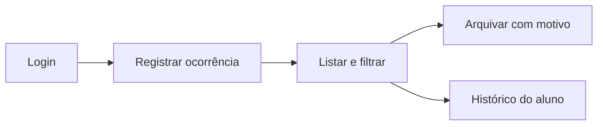
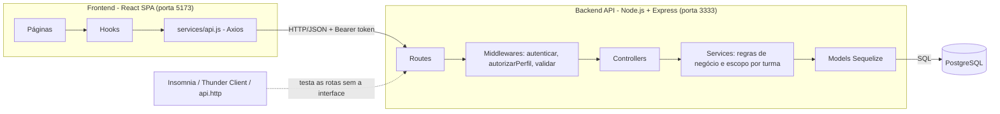
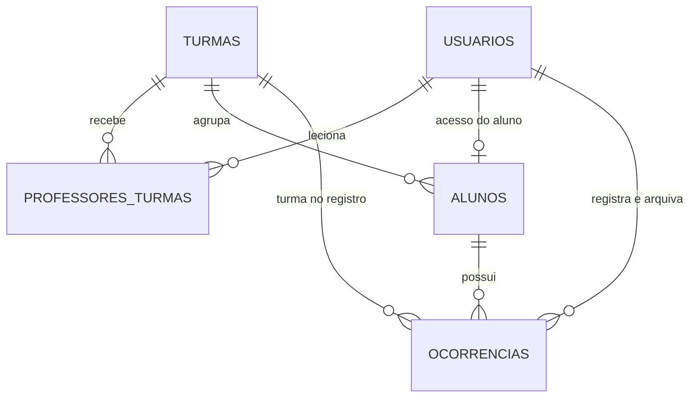
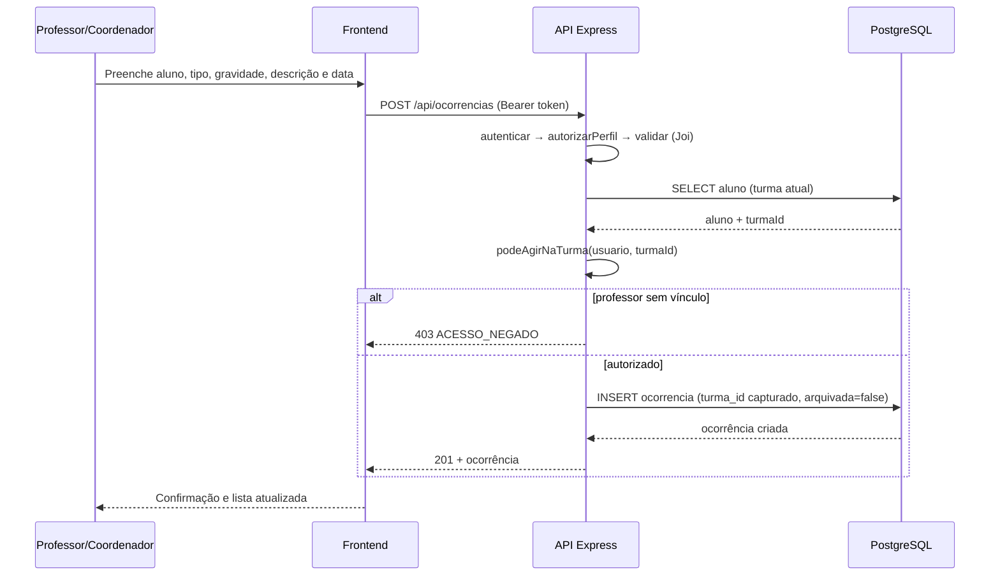
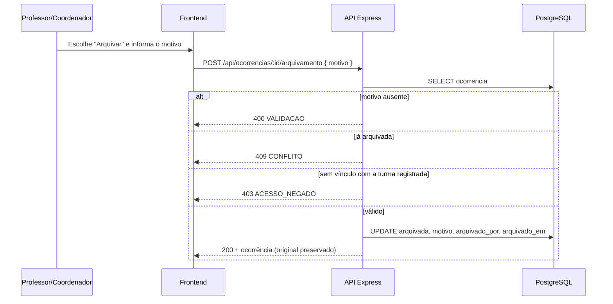

# Design.md — Ocorrência+ (Módulo de Ocorrências Disciplinares)

| **Versão**     | 3.2                                                                 |
| -------------- | ------------------------------------------------------------------- |
| **Data**       | 14/10/2026                                                          |
| **Autores**    | Enzo e Lucas Rafael                                                 |
| **Baseado em** | `Requirements.md` v2.2 · Protótipo Figma "Ocorrência+"              |
| **Atividade**  | 3º Bimestre — SPECS (Requirements · Design · Tasks)                 |

## Histórico de revisões

| Versão | Data       | Descrição                                                                                                                                                                                 |
| ------ | ---------- | ----------------------------------------------------------------------------------------------------------------------------------------------------------------------------------------- |
| 1.0    | 18/08/2026 | Versão inicial (Presença+).                                                                                                                                                               |
| 2.x    | 08/10/2026 | Alinhamento ao Figma (identidade, painel, alunos, sobreposições). Arquivada em `versoes_anteriores/`.                                                                                     |
| 3.0    | 08/10/2026 | **Reestruturação para a atividade do 3º bimestre**: começa pelo propósito principal; backend API (Node + Express + PostgreSQL + Sequelize) com rotas detalhadas e testáveis; componentes do frontend por página; itens do Figma fora do escopo removidos. |
| 3.1    | 09/10/2026 | **Revisão de consistência**: trigger de `UPDATE` no banco (RNF1); escopo do professor nos contadores R12/R13 e no aluno transferido (R09); "Destaque positivo" fora do critério "em atenção" (R21); senha inicial = matrícula; limite de tentativas no login (`429`); versões de Node, Express, React e Tailwind atualizadas. |
| 3.2    | 14/10/2026 | **Revisão final**: nome do arquivo padronizado (`Design.md`); removido ponto em aberto sobre dados do mock do Figma (não pertence à especificação). |

### Sumário

1. [Resumo executivo](#resumo-executivo)
2. [Propósito e escopo do design](#1-propósito-e-escopo-do-design)
3. [Arquitetura](#2-arquitetura)
4. [Backend API (Node.js + Express + PostgreSQL + Sequelize)](#3-backend-api)
5. [Frontend (React) — componentes por página](#4-frontend-react--componentes-por-página)
6. [Propriedades de corretude](#5-propriedades-de-corretude)
7. [Estratégia de testes](#6-estratégia-de-testes)
8. [Mapa Figma → escopo](#7-mapa-figma--escopo)
9. [Fora de escopo e pontos em aberto](#8-fora-de-escopo-e-pontos-em-aberto)

---

## Resumo executivo

Este documento organiza o design do módulo Ocorrência+ como uma solução web focada no registro disciplinar, na consulta e no arquivamento de ocorrências. O objetivo central é permitir que professores e coordenadores gerenciem ocorrências de forma segura, rastreável e consistente, preservando a integridade histórica do aluno e da turma.

### Objetivo principal

> **O Ocorrência+ existe para REGISTRAR OCORRÊNCIAS.**
> Todo o design parte dessa ação. O que não ajuda a registrar, consultar ou proteger uma ocorrência não entra no escopo deste módulo.

### Público e papéis

- **Coordenador:** gerencia turmas, alunos, vínculos e visualiza o conjunto de ocorrências do sistema.
- **Professor:** registra e arquiva ocorrências apenas para turmas vinculadas; consulta dados do aluno e da turma autorizados.
- **Aluno:** consulta seu histórico pessoal; não registra nem arquiva ocorrências.

### Fluxo principal que o design precisa sustentar



### Ordem de construção

| Ordem | O que                                                                 | Onde      |
| :---: | --------------------------------------------------------------------- | --------- |
| 1     | **Rotas da API testáveis** (contrato antes da implementação)          | Backend   |
| 2     | Banco, modelos, autenticação e regras do núcleo (registrar → arquivar)| Backend   |
| 3     | Cadastros de apoio (turmas, alunos, vínculos)                         | Backend   |
| 4     | Telas do núcleo (login, ocorrências, registrar, arquivar, histórico)  | Frontend  |
| 5     | Telas de apoio (alunos, cadastros, visão do aluno)                    | Frontend  |
| 6     | **Painel simples (complementar, por último)**                         | Back + Front |

### Como ler este documento

1. Leitura rápida: [Resumo executivo](#resumo-executivo), [1. Propósito e escopo do design](#1-propósito-e-escopo-do-design) e [2. Arquitetura](#2-arquitetura).
2. Implementação: [3. Backend API](#3-backend-api) e [4. Frontend](#4-frontend-react--componentes-por-página).
3. Validação: [5. Propriedades de corretude](#5-propriedades-de-corretude), [6. Estratégia de testes](#6-estratégia-de-testes) e [8. Fora de escopo](#8-fora-de-escopo-e-pontos-em-aberto).

### Decisões principais

- **Existe um backend API em Node.js.** Toda regra de negócio e toda autorização vivem na API; o frontend só consome rotas.
- **Stack do backend:** Node.js 22 LTS (ou superior) · **Express 5** · **PostgreSQL** · **Sequelize** (ORM) · JWT · bcryptjs · Joi · express-rate-limit.
- **Banco relacional:** RN1 (imutabilidade) e RN5 (turma preservada) dependem de constraints e integridade referencial.
- **Contrato primeiro:** as rotas são definidas e ficam testáveis (respostas simuladas) **antes** de qualquer tela ou lógica; isso é a **primeira tarefa**.
- **Autorização no backend (RNF3):** professor sem vínculo recebe `403` mesmo manipulando a requisição.
- **Imutabilidade em duas camadas (RNF1):** na API (não existe edição/exclusão → `405`) e no banco (triggers `BEFORE DELETE` e `BEFORE UPDATE`; o hook do modelo Sequelize é uma defesa adicional na aplicação).
- **Turma capturada no registro (RN5):** `ocorrencias.turma_id` é gravado no `INSERT` e nunca atualizado.
- **JavaScript** em backend e frontend, para reduzir complexidade com Sequelize (TypeScript fica como evolução).
- **IDs em UUID**, para que um aluno não consiga "adivinhar" identificadores sequenciais (Req. 4, critério 5).
- **Interface desktop-first** (notebook 14" como referência), utilizável em tablet.

---

## 1. Propósito e escopo do design

### 1.1 Objetivo do produto

O módulo deve permitir que a instituição registre, consulte, filtre, proteja e historize ocorrências disciplinares, sem deixar que regras de negócio fiquem dependentes da interface.

### 1.2 Escopo funcional principal

- Registro de ocorrência por professor/coordenador.
- Listagem e filtragem por situação, tipo, gravidade, aluno, turma e período.
- Arquivamento com justificativa obrigatória.
- Histórico de ocorrências por aluno.
- Acesso restrito por vínculo turma-professor.
- Segurança de integridade e de autorização.

### 1.3 Personas e permissões

| Papel | Permissões principais | Restrições |
| ----- | -------------------- | ---------- |
| Coordenador | Visualiza todas as ocorrências, cadastra turmas/alunos e gerencia vínculos | Nenhuma para o módulo |
| Professor | Registra e arquiva ocorrências para turmas vinculadas | Não pode agir fora das turmas em que leciona |
| Aluno | Consulta o próprio histórico | Não pode registrar/arquivar |

### 1.4 Regras de negócio centrais

- **RN1:** ocorrências são imutáveis em termos de conteúdo; a única ação permitida é arquivamento.
- **RN3:** professor só pode registrar dentro das turmas em que atua.
- **RN5:** a turma da ocorrência é registrada no momento do cadastro e nunca alterada.
- **RNF1:** proteção na API e no banco (triggers de `DELETE` e `UPDATE`), com hooks do modelo como defesa adicional.
- **RNF3:** autorização é validada no backend.

### 1.5 Escopo do design

Este design cobre:

- backend API
- regras de autenticação e autorização
- contratos e payloads
- estrutura de dados e relacionamentos
- fluxos de registro, listagem e arquivamento
- telas principais para a jornada do usuário

Este design exclui:

- notificações automáticas para responsáveis
- anexos em ocorrências
- exportação em massa
- painel analítico avançado
- integração com outros sistemas externos

---

## 2. Arquitetura



### 2.1 Camadas do backend

| Camada        | Responsabilidade                                                                  | Pasta                  |
| ------------- | --------------------------------------------------------------------------------- | ---------------------- |
| Routes        | Declara método + caminho e encadeia middlewares                                   | `src/routes`           |
| Middlewares   | Autenticação (JWT), perfil, validação de entrada, tratamento de erros             | `src/middlewares`      |
| Controllers   | Lê `req`, chama o service, devolve `res` (sem regra de negócio)                   | `src/controllers`      |
| Services      | Regras de negócio: escopo por turma, captura da turma (RN5), arquivamento         | `src/services`         |
| Models        | Tabelas, associações, hooks de imutabilidade (RN1)                                | `src/models`           |
| Database      | Conexão, migrations, seeders                                                      | `src/database`         |

### 2.2 Estrutura de pastas

```
ocorrencia-mais/
├── backend/
│   ├── src/
│   │   ├── app.js                 # Express: cors, json, rotas, tratador de erros
│   │   ├── server.js              # app.listen(PORT)
│   │   ├── config/database.js     # credenciais lidas do .env
│   │   ├── database/
│   │   │   ├── migrations/        # criação das tabelas e do trigger
│   │   │   └── seeders/           # coordenador, professores, turmas, alunos
│   │   ├── models/                # index.js, Usuario, Turma, Aluno, ProfessorTurma, Ocorrencia
│   │   ├── routes/                # index.js, auth, ocorrencias, alunos, turmas, painel
│   │   ├── controllers/
│   │   ├── services/              # ocorrencia.service.js, escopo.service.js, ...
│   │   ├── middlewares/           # autenticar.js, autorizarPerfil.js, validar.js, erros.js
│   │   ├── validators/            # esquemas Joi
│   │   └── utils/ErroApp.js
│   ├── tests/                     # Jest + Supertest
│   ├── api.http                   # requisições de teste das rotas
│   ├── .env.example
│   ├── .sequelizerc
│   └── package.json
└── frontend/
    └── src/
        ├── main.jsx · App.jsx
        ├── services/api.js
        ├── contexts/AuthContext.jsx
        ├── routes/ProtectedRoute.jsx
        ├── components/{ui,layout,ocorrencias,alunos,cadastros}/
        ├── pages/
        ├── hooks/
        └── utils/{constantes.js,formatadores.js}
```

---

## 3. Backend API

### 3.1 Convenções

| Item              | Definição                                                                                                  |
| ----------------- | ---------------------------------------------------------------------------------------------------------- |
| URL base (dev)    | `http://localhost:3333/api`                                                                                |
| Formato           | JSON (`Content-Type: application/json`); datas `YYYY-MM-DD`; data/hora ISO 8601                            |
| Autenticação      | `Authorization: Bearer <token>` (JWT, expira em 8 h; payload: `sub` = id do usuário, `perfil`)             |
| IDs               | UUID v4                                                                                                    |
| Paginação         | `?page=1&pageSize=10` (máx. 50) → `{ "itens": [], "total": 0, "page": 1, "pageSize": 10 }`                 |
| Situação          | `?situacao=ativas` (padrão) \| `arquivadas` \| `todas`                                                     |
| Códigos HTTP      | `200` ok · `201` criado · `400` validação · `401` não autenticado · `403` acesso negado · `404` não encontrado · `405` método não permitido · `409` conflito |

**Formato único de erro (RNF6):**

```json
{
  "codigo": "VALIDACAO",
  "mensagem": "Dados inválidos.",
  "detalhes": [
    { "campo": "descricao", "mensagem": "A descrição deve ter entre 1 e 500 caracteres." }
  ]
}
```

| `codigo`              | HTTP | Quando                                                              |
| --------------------- | :--: | ------------------------------------------------------------------- |
| `VALIDACAO`           | 400  | Campo ausente/inválido                                              |
| `CREDENCIAIS_INVALIDAS` | 401 | Matrícula ou senha incorretas                                       |
| `NAO_AUTENTICADO`     | 401  | Token ausente, inválido ou expirado                                 |
| `ACESSO_NEGADO`       | 403  | Perfil sem permissão ou professor sem vínculo; aluno em dado alheio |
| `NAO_ENCONTRADO`      | 404  | Recurso inexistente                                                 |
| `METODO_NAO_PERMITIDO`| 405  | Tentativa de editar/excluir ocorrência                              |
| `CONFLITO`            | 409  | Duplicidade (turma, matrícula) ou ocorrência já arquivada           |
| `MUITAS_TENTATIVAS`   | 429  | Limite de tentativas de login excedido                              |
| `ERRO_INTERNO`        | 500  | Falha inesperada                                                    |

### 3.2 Tabela geral de rotas

> **Ordem de implementação = ordem das Tasks.** O grupo **Núcleo** é implementado e testado primeiro (Tarefa 1.1 cria todas as rotas do núcleo com resposta simulada).

| ID  | Grupo         | Método | Rota                                  | Perfis                                   | Req.        |
| --- | ------------- | ------ | ------------------------------------- | ---------------------------------------- | ----------- |
| R01 | Núcleo        | GET    | `/api/health`                         | público                                  | RNF5        |
| R02 | Núcleo        | POST   | `/api/auth/login`                     | público                                  | 5           |
| R03 | Núcleo        | GET    | `/api/auth/me`                        | autenticado                              | 5           |
| R04 | **Núcleo**    | **POST** | **`/api/ocorrencias`**              | professor\*, coordenador                 | **1**       |
| R05 | Núcleo        | GET    | `/api/ocorrencias`                    | professor\*, coordenador                 | 2           |
| R06 | Núcleo        | GET    | `/api/ocorrencias/:id`                | professor\*, coordenador, aluno\*\*      | 2, 4        |
| R07 | Núcleo        | POST   | `/api/ocorrencias/:id/arquivamento`   | professor\*, coordenador                 | 3           |
| R08 | Núcleo        | PUT/PATCH/DELETE | `/api/ocorrencias/:id`      | todos → sempre `405`                     | 1 (6–7)     |
| R09 | Núcleo        | GET    | `/api/alunos/:id/ocorrencias`         | professor\*, coordenador, aluno\*\*      | 4           |
| R10 | Núcleo        | GET    | `/api/me/ocorrencias`                 | aluno                                    | 4           |
| R11 | Apoio         | GET    | `/api/turmas`                         | professor\*, coordenador                 | 2, 6        |
| R12 | Apoio         | GET    | `/api/alunos`                         | professor\*, coordenador                 | 1, 6        |
| R13 | Apoio         | GET    | `/api/alunos/:id`                     | professor\*, coordenador, aluno\*\*      | 4           |
| R14 | Apoio         | POST   | `/api/turmas`                         | coordenador                              | 6           |
| R15 | Apoio         | POST   | `/api/alunos`                         | coordenador                              | 6           |
| R16 | Apoio         | PATCH  | `/api/alunos/:id/turma`               | coordenador                              | 6           |
| R17 | Apoio         | GET    | `/api/professores`                    | coordenador                              | 6           |
| R18 | Apoio         | GET    | `/api/turmas/:id/professores`         | coordenador                              | 6           |
| R19 | Apoio         | POST   | `/api/turmas/:id/professores`         | coordenador                              | 6           |
| R20 | Complementar  | GET    | `/api/painel/turmas`                  | coordenador                              | 7           |
| R21 | Complementar  | GET    | `/api/painel/alunos-em-atencao`       | coordenador                              | 7           |

\* professor: apenas turmas vinculadas (`403` caso contrário). \*\* aluno: apenas o próprio registro.

### 3.3 Detalhamento das rotas do núcleo

#### R01 — `GET /api/health`
Verifica se a API está no ar. **Resposta 200:** `{ "status": "ok", "banco": "conectado" }` (na Tarefa 1.1 ainda sem banco: `"banco": "nao-configurado"`).

---

#### R02 — `POST /api/auth/login`  _(Req. 5)_

| Item        | Definição                                                              |
| ----------- | ---------------------------------------------------------------------- |
| Perfis      | público                                                                |
| Body        | `matricula` (string, obrigatório) · `senha` (string, obrigatório)      |
| Regras      | Compara a senha com o hash (bcrypt); mensagem **genérica** em caso de erro; limite de tentativas por IP (`express-rate-limit`, ex.: 10 a cada 15 min → `429 MUITAS_TENTATIVAS`) |

Requisição:
```json
{ "matricula": "2026000001", "senha": "senha123" }
```
Resposta **200**:
```json
{
  "token": "eyJhbGciOiJIUzI1NiIsInR5cCI6IkpXVCJ9...",
  "usuario": { "id": "b1d6...", "nome": "Verônica Lima", "matricula": "2026000001", "perfil": "coordenador" }
}
```
Erros: `400 VALIDACAO` (campo vazio) · `401 CREDENCIAIS_INVALIDAS` — "Matrícula ou senha inválidos."

---

#### R03 — `GET /api/auth/me`
Devolve o usuário do token (usado pelo frontend ao recarregar a página). **200:** `{ "id", "nome", "matricula", "perfil" }` · **401** `NAO_AUTENTICADO`.

---

#### R04 — `POST /api/ocorrencias`  _(Req. 1 — a rota mais importante do projeto)_

| Item      | Definição                                                                                                       |
| --------- | --------------------------------------------------------------------------------------------------------------- |
| Perfis    | professor (somente turmas vinculadas), coordenador                                                              |
| Body      | `alunoId` (UUID, obrigatório) · `tipo` (enum, obrigatório) · `gravidade` (enum, obrigatório) · `descricao` (1–500 caracteres) · `data` (`YYYY-MM-DD`, não futura) · `referenciaId` (UUID, opcional — correção de uma ocorrência anterior do mesmo aluno) |
| Regras    | 1) aluno deve existir; 2) professor precisa de vínculo com a turma **atual** do aluno; 3) a API grava `turmaId` = turma atual do aluno (RN5); 4) situação inicial = ativa; 5) `criadoPor` = usuário do token (nunca vindo do body) |

Requisição:
```json
{
  "alunoId": "0f5c3b1e-8d7a-4f0a-9d7e-2a6c1b9e4a10",
  "tipo": "uso_indevido_celular",
  "gravidade": "leve",
  "descricao": "Utilizou o celular durante a explicação de Matemática, mesmo após ser advertido.",
  "data": "2026-05-12"
}
```
Resposta **201**:
```json
{
  "id": "7a2e9c44-51b3-4f6e-8c2d-0e3f6a1b9d55",
  "aluno": { "id": "0f5c3b1e-8d7a-4f0a-9d7e-2a6c1b9e4a10", "nome": "Ana Clara Silva", "matricula": "2026010101" },
  "turma": { "id": "c3a1...", "nome": "8º A" },
  "tipo": "uso_indevido_celular",
  "gravidade": "leve",
  "descricao": "Utilizou o celular durante a explicação de Matemática, mesmo após ser advertido.",
  "data": "2026-05-12",
  "arquivada": false,
  "arquivamento": null,
  "referenciaId": null,
  "criadoPor": { "id": "e9b0...", "nome": "Prof. Marcos Andrade" },
  "criadoEm": "2026-05-12T14:03:21.000Z"
}
```

| Erro | Quando |
| ---- | ------ |
| `400 VALIDACAO` | Campo ausente/inválido, tipo ou gravidade fora da lista, descrição > 500, data futura |
| `401 NAO_AUTENTICADO` | Sem token |
| `403 ACESSO_NEGADO` | Aluno tentando registrar; professor sem vínculo com a turma do aluno ("Acesso restrito às turmas em que você leciona.") |
| `404 NAO_ENCONTRADO` | `alunoId` (ou `referenciaId`) inexistente |

---

#### R05 — `GET /api/ocorrencias`  _(Req. 2)_

| Query                | Tipo                | Padrão    | Descrição                                          |
| -------------------- | ------------------- | --------- | -------------------------------------------------- |
| `situacao`           | `ativas\|arquivadas\|todas` | `ativas` | Filtro de situação                              |
| `q`                  | string              | —         | Nome **ou** matrícula do aluno (contém)            |
| `turmaId`            | UUID                | —         | Turma **registrada** na ocorrência                 |
| `tipo`               | enum                | —         | Um dos 5 tipos                                     |
| `gravidade`          | enum                | —         | `leve`, `media`, `grave`                           |
| `dataInicio`/`dataFim` | `YYYY-MM-DD`      | —         | Período (inclusivo)                                |
| `page`/`pageSize`    | int                 | 1 / 10    | Paginação (máx. 50)                                |

Regras: ordenação por `data` decrescente e depois `criadoEm` decrescente; professor recebe **apenas** ocorrências das turmas vinculadas; se `turmaId` for de turma não vinculada → `403`.

Resposta **200** (itens no mesmo formato da R04):
```json
{
  "itens": [ { "id": "7a2e...", "aluno": { "nome": "Ana Clara Silva" }, "turma": { "nome": "8º A" }, "tipo": "uso_indevido_celular", "gravidade": "leve", "data": "2026-05-12", "arquivada": false } ],
  "total": 48,
  "page": 1,
  "pageSize": 10
}
```
Lista vazia → `200` com `"itens": []` e `"total": 0` (a interface exibe a mensagem de "nenhuma ocorrência").

---

#### R06 — `GET /api/ocorrencias/:id`
Detalhe completo (formato da R04). Se arquivada, `arquivamento` vem preenchido:
```json
"arquivada": true,
"arquivamento": {
  "motivo": "Registro lançado no aluno errado.",
  "por": { "id": "b1d6...", "nome": "Verônica Lima" },
  "em": "2026-05-13T09:10:00.000Z"
}
```
Erros: `404` (inexistente) · `403` (professor sem vínculo com a turma registrada; aluno que não é o titular).

---

#### R07 — `POST /api/ocorrencias/:id/arquivamento`  _(Req. 3)_

| Item   | Definição                                                                                         |
| ------ | ------------------------------------------------------------------------------------------------- |
| Perfis | professor (turma **registrada** na ocorrência deve ser vinculada), coordenador                    |
| Body   | `motivo` (string, 1–500, obrigatório)                                                             |
| Regras | grava `arquivada=true`, `motivoArquivamento`, `arquivadoPor`, `arquivadoEm`; **não altera** nenhum outro campo |

Requisição: `{ "motivo": "Registro lançado no aluno errado." }`
Resposta **200:** ocorrência no formato R06, com `arquivada: true`.
Erros: `400` (motivo ausente) · `403` · `404` · `409 CONFLITO` ("Esta ocorrência já está arquivada.").

---

#### R08 — `PUT | PATCH | DELETE /api/ocorrencias/:id`  _(Req. 1, critérios 6–7)_
Rotas **existem apenas para recusar**. Resposta **405** para qualquer perfil:
```json
{
  "codigo": "METODO_NAO_PERMITIDO",
  "mensagem": "Ocorrências não podem ser editadas ou excluídas. Registre uma nova ocorrência ou arquive esta."
}
```

---

#### R09 — `GET /api/alunos/:id/ocorrencias`  _(Req. 4)_
Histórico de um aluno. Query: `situacao`, `tipo`, `gravidade`, `dataInicio`, `dataFim`, `page`, `pageSize`.

Resposta **200:**
```json
{
  "aluno": { "id": "0f5c...", "nome": "Ana Clara Silva", "matricula": "2026010101", "turmaAtual": { "id": "c3a1...", "nome": "8º A" } },
  "itens": [ { "id": "7a2e...", "turma": { "nome": "7º A" }, "tipo": "atraso", "gravidade": "leve", "data": "2025-11-04", "arquivada": false } ],
  "total": 3, "page": 1, "pageSize": 10
}
```
Regras: cada item traz a **turma registrada** (RN5), não a turma atual; professor vê só itens de turmas vinculadas e acessa o aluno se ele está hoje em turma vinculada **ou** tem ocorrência registrada em turma vinculada (aluno transferido); aluno só se `:id` for o seu (`403` caso contrário).

---

#### R10 — `GET /api/me/ocorrencias`
Mesmo formato da R09, sempre para o **aluno do token** (o aluno não informa id). Perfis: aluno. Professor/coordenador → `403`.

### 3.4 Detalhamento das rotas de apoio

| ID  | Rota                                | Entrada                                                                  | Saída (200/201)                                                                                          | Erros                                                           |
| --- | ----------------------------------- | ------------------------------------------------------------------------ | -------------------------------------------------------------------------------------------------------- | --------------------------------------------------------------- |
| R11 | `GET /api/turmas`                   | —                                                                        | `[ { "id", "nome" } ]` — coordenador: todas; professor: vinculadas                                        | 401                                                             |
| R12 | `GET /api/alunos`                   | `q` (nome/matrícula), `turmaId`, `page`, `pageSize`                      | `{ itens: [ { id, nome, matricula, turma:{id,nome}, totalOcorrenciasAtivas, ultimaOcorrenciaEm } ], total, page, pageSize }` — professor: só alunos de turmas vinculadas, e os contadores (`totalOcorrenciasAtivas`, `ultimaOcorrenciaEm`) consideram só ocorrências de turmas vinculadas | 401, 403 (turma não vinculada)                                  |
| R13 | `GET /api/alunos/:id`               | —                                                                        | `{ id, nome, matricula, turma, resumo: { totalAtivas, graves, arquivadas, ultimaOcorrenciaEm } }` — para professor, o resumo conta só ocorrências de turmas vinculadas         | 403, 404                                                        |
| R14 | `POST /api/turmas`                  | `{ "nome": "8º A" }` (1–30)                                              | `201 { id, nome }`                                                                                       | 400, 403, 409 (nome duplicado)                                  |
| R15 | `POST /api/alunos`                  | `{ nome, matricula, turmaId }`                                           | `201 { id, nome, matricula, turma }` — cria também o usuário de acesso do aluno (senha inicial provisória = matrícula) | 400, 403, 404 (turma), 409 (matrícula duplicada)                |
| R16 | `PATCH /api/alunos/:id/turma`       | `{ "turmaId": "..." }`                                                   | `200` aluno com a nova turma — **não toca** nas ocorrências existentes (RN5)                              | 400, 403, 404, 409 (já está nessa turma)                        |
| R17 | `GET /api/professores`              | —                                                                        | `[ { id, nome, matricula } ]`                                                                             | 403                                                             |
| R18 | `GET /api/turmas/:id/professores`   | —                                                                        | `[ { id, nome, matricula } ]` vinculados à turma                                                          | 403, 404                                                        |
| R19 | `POST /api/turmas/:id/professores`  | `{ "professorId": "..." }`                                               | `201 { turmaId, professorId }`                                                                           | 400, 403, 404, 409 (já vinculado)                               |

### 3.5 Rotas complementares (Req. 7 — só após o núcleo)

| ID  | Rota                                        | Query                          | Saída                                                                                                                                   |
| --- | ------------------------------------------- | ------------------------------ | --------------------------------------------------------------------------------------------------------------------------------------- |
| R20 | `GET /api/painel/turmas`                    | `periodoDias` = 30 \| 60 \| 90 (padrão 30) | `[ { turmaId, nome, totalAtivas, porGravidade: { leve, media, grave }, porTipo: { atraso, indisciplina, ... } } ]`            |
| R21 | `GET /api/painel/alunos-em-atencao`         | `periodoDias`, `turmaId`       | `[ { alunoId, nome, matricula, turma, totalAtivas, graves } ]` — regra: `graves >= 3` **ou** `totalAtivas >= 5`; arquivadas e ocorrências do tipo `destaque_positivo` não contam |

### 3.6 Modelo de dados



| Tabela               | Colunas                                                                                                                                                                                                                                                  |
| -------------------- | -------------------------------------------------------------------------------------------------------------------------------------------------------------------------------------------------------------------------------------------------------- |
| `usuarios`           | `id` UUID PK · `nome` · `matricula` **UNIQUE** · `senha_hash` · `perfil` ENUM(professor, coordenador, aluno)                                                                                                                                             |
| `turmas`             | `id` UUID PK · `nome` **UNIQUE**                                                                                                                                                                                                                         |
| `alunos`             | `id` UUID PK · `nome` · `matricula` **UNIQUE** · `turma_id` FK → turmas · `usuario_id` FK → usuarios (nullable)                                                                                                                                          |
| `professores_turmas` | `professor_id` FK → usuarios · `turma_id` FK → turmas · **PK composta** (professor_id, turma_id)                                                                                                                                                         |
| `ocorrencias`        | `id` UUID PK · `aluno_id` FK · **`turma_id` FK (turma no registro, imutável)** · `tipo` ENUM · `gravidade` ENUM · `descricao` VARCHAR(500) · `data_ocorrencia` DATE · `criado_por` FK · `criado_em` · `arquivada` BOOLEAN (padrão `false`) · `motivo_arquivamento` · `arquivado_por` FK · `arquivado_em` · `referencia_id` FK → ocorrencias (nullable) |

**Índices:** `ocorrencias (aluno_id, data_ocorrencia DESC)` · `ocorrencias (turma_id, data_ocorrencia DESC)` · `ocorrencias (arquivada)` · `alunos (turma_id)`.

**Reforço no banco (RNF1)** — migrations extras com **dois triggers** que impedem a exclusão física **e** a alteração do conteúdo mesmo fora da API (SQL direto). Primeiro, o de exclusão:

```sql
CREATE OR REPLACE FUNCTION bloquear_exclusao_ocorrencia() RETURNS trigger AS $$
BEGIN
  RAISE EXCEPTION 'Ocorrências não podem ser excluídas';
END;
$$ LANGUAGE plpgsql;

CREATE TRIGGER trg_ocorrencias_sem_delete
BEFORE DELETE ON ocorrencias
FOR EACH ROW EXECUTE FUNCTION bloquear_exclusao_ocorrencia();
```

Segundo, o de alteração: só a transição ativa → arquivada é aceita (e o arquivamento é definitivo, sem "desarquivar"):

```sql
CREATE OR REPLACE FUNCTION bloquear_alteracao_ocorrencia() RETURNS trigger AS $$
BEGIN
  IF NEW.id IS DISTINCT FROM OLD.id
     OR NEW.aluno_id IS DISTINCT FROM OLD.aluno_id
     OR NEW.turma_id IS DISTINCT FROM OLD.turma_id
     OR NEW.tipo IS DISTINCT FROM OLD.tipo
     OR NEW.gravidade IS DISTINCT FROM OLD.gravidade
     OR NEW.descricao IS DISTINCT FROM OLD.descricao
     OR NEW.data_ocorrencia IS DISTINCT FROM OLD.data_ocorrencia
     OR NEW.criado_por IS DISTINCT FROM OLD.criado_por
     OR NEW.criado_em IS DISTINCT FROM OLD.criado_em
     OR NEW.referencia_id IS DISTINCT FROM OLD.referencia_id THEN
    RAISE EXCEPTION 'Ocorrências não podem ser alteradas';
  END IF;

  IF OLD.arquivada AND (
       NEW.arquivada IS DISTINCT FROM OLD.arquivada
    OR NEW.motivo_arquivamento IS DISTINCT FROM OLD.motivo_arquivamento
    OR NEW.arquivado_por IS DISTINCT FROM OLD.arquivado_por
    OR NEW.arquivado_em IS DISTINCT FROM OLD.arquivado_em) THEN
    RAISE EXCEPTION 'Ocorrência arquivada não pode ser alterada';
  END IF;

  RETURN NEW;
END;
$$ LANGUAGE plpgsql;

CREATE TRIGGER trg_ocorrencias_sem_update
BEFORE UPDATE ON ocorrencias
FOR EACH ROW EXECUTE FUNCTION bloquear_alteracao_ocorrencia();
```

### 3.7 Modelos Sequelize (referência)

**`models/Ocorrencia.js`** — o modelo central; os hooks implementam a RN1:

```js
const { DataTypes } = require('sequelize');

module.exports = (sequelize) => {
  const Ocorrencia = sequelize.define('Ocorrencia', {
    id: { type: DataTypes.UUID, defaultValue: DataTypes.UUIDV4, primaryKey: true },
    alunoId: { type: DataTypes.UUID, allowNull: false },
    turmaId: { type: DataTypes.UUID, allowNull: false }, // turma do aluno NO MOMENTO do registro (RN5)
    tipo: {
      type: DataTypes.ENUM('atraso', 'indisciplina', 'uso_indevido_celular', 'dano_patrimonio', 'destaque_positivo'),
      allowNull: false,
    },
    gravidade: { type: DataTypes.ENUM('leve', 'media', 'grave'), allowNull: false },
    descricao: { type: DataTypes.STRING(500), allowNull: false, validate: { len: [1, 500] } },
    dataOcorrencia: { type: DataTypes.DATEONLY, allowNull: false },
    criadoPor: { type: DataTypes.UUID, allowNull: false },
    arquivada: { type: DataTypes.BOOLEAN, allowNull: false, defaultValue: false },
    motivoArquivamento: { type: DataTypes.STRING(500) },
    arquivadoPor: { type: DataTypes.UUID },
    arquivadoEm: { type: DataTypes.DATE },
    referenciaId: { type: DataTypes.UUID },
  }, {
    tableName: 'ocorrencias',
    underscored: true,
    createdAt: 'criadoEm',
    updatedAt: false,
  });

  // RN1: somente os campos de arquivamento podem mudar depois do registro
  const CAMPOS_ARQUIVAMENTO = ['arquivada', 'motivoArquivamento', 'arquivadoPor', 'arquivadoEm'];

  Ocorrencia.beforeUpdate((ocorrencia) => {
    const alterados = ocorrencia.changed().filter((campo) => !CAMPOS_ARQUIVAMENTO.includes(campo));
    if (alterados.length > 0) throw new Error('OCORRENCIA_IMUTAVEL');
  });

  Ocorrencia.beforeDestroy(() => {
    throw new Error('OCORRENCIA_NAO_PODE_SER_EXCLUIDA');
  });

  return Ocorrencia;
};
```

> Os hooks valem para `instancia.save()`. Por isso o código **nunca** usa `Ocorrencia.update(...)`/`destroy(...)` em massa — e os triggers do banco (`DELETE` e `UPDATE`) cobrem qualquer exceção, inclusive SQL direto.

**`models/Aluno.js`** (os demais seguem o mesmo padrão):

```js
const { DataTypes } = require('sequelize');

module.exports = (sequelize) =>
  sequelize.define('Aluno', {
    id: { type: DataTypes.UUID, defaultValue: DataTypes.UUIDV4, primaryKey: true },
    nome: { type: DataTypes.STRING(120), allowNull: false },
    matricula: { type: DataTypes.STRING(20), allowNull: false, unique: true },
    turmaId: { type: DataTypes.UUID, allowNull: false },   // turma ATUAL (muda na transferência)
    usuarioId: { type: DataTypes.UUID },
  }, { tableName: 'alunos', underscored: true });
```

**`models/index.js`** — associações:

```js
Turma.hasMany(Aluno, { foreignKey: 'turmaId', as: 'alunos' });
Aluno.belongsTo(Turma, { foreignKey: 'turmaId', as: 'turma' });
Aluno.belongsTo(Usuario, { foreignKey: 'usuarioId', as: 'usuario' });

Aluno.hasMany(Ocorrencia, { foreignKey: 'alunoId', as: 'ocorrencias' });
Ocorrencia.belongsTo(Aluno, { foreignKey: 'alunoId', as: 'aluno' });
Ocorrencia.belongsTo(Turma, { foreignKey: 'turmaId', as: 'turma' });
Ocorrencia.belongsTo(Usuario, { foreignKey: 'criadoPor', as: 'autor' });
Ocorrencia.belongsTo(Usuario, { foreignKey: 'arquivadoPor', as: 'arquivador' });

Usuario.belongsToMany(Turma, { through: ProfessorTurma, foreignKey: 'professorId', otherKey: 'turmaId', as: 'turmasLecionadas' });
Turma.belongsToMany(Usuario, { through: ProfessorTurma, foreignKey: 'turmaId', otherKey: 'professorId', as: 'professores' });
```

### 3.8 Middlewares e regras (referência)

```js
// middlewares/autenticar.js
const jwt = require('jsonwebtoken');

module.exports = (req, res, next) => {
  const [esquema, token] = (req.headers.authorization || '').split(' ');
  if (esquema !== 'Bearer' || !token) {
    return res.status(401).json({ codigo: 'NAO_AUTENTICADO', mensagem: 'Faça login para continuar.' });
  }
  try {
    const { sub, perfil } = jwt.verify(token, process.env.JWT_SECRET);
    req.usuario = { id: sub, perfil };
    return next();
  } catch {
    return res.status(401).json({ codigo: 'NAO_AUTENTICADO', mensagem: 'Sessão inválida ou expirada.' });
  }
};

// middlewares/autorizarPerfil.js
module.exports = (...perfis) => (req, res, next) =>
  perfis.includes(req.usuario.perfil)
    ? next()
    : res.status(403).json({ codigo: 'ACESSO_NEGADO', mensagem: 'Acesso negado.' });
```

```js
// services/escopo.service.js — define em quais turmas o usuário pode agir
async function turmasPermitidas(usuario) {            // null = todas (coordenador)
  if (usuario.perfil === 'coordenador') return null;
  if (usuario.perfil === 'professor') {
    const vinculos = await ProfessorTurma.findAll({ where: { professorId: usuario.id }, attributes: ['turmaId'] });
    return vinculos.map((v) => v.turmaId);
  }
  return [];                                          // aluno: nenhuma turma
}

async function podeAgirNaTurma(usuario, turmaId) {
  const permitidas = await turmasPermitidas(usuario);
  return permitidas === null || permitidas.includes(turmaId);
}
```

```js
// services/ocorrencia.service.js — registrar (RN3 + RN5) e arquivar (RN1)
async function registrar(usuario, dados) {
  const aluno = await Aluno.findByPk(dados.alunoId);
  if (!aluno) throw new ErroApp(404, 'NAO_ENCONTRADO', 'Aluno não encontrado.');

  if (!(await podeAgirNaTurma(usuario, aluno.turmaId))) {
    throw new ErroApp(403, 'ACESSO_NEGADO', 'Acesso restrito às turmas em que você leciona.');
  }

  return Ocorrencia.create({
    alunoId: aluno.id,
    turmaId: aluno.turmaId,            // RN5: captura a turma atual
    tipo: dados.tipo,
    gravidade: dados.gravidade,
    descricao: dados.descricao,
    dataOcorrencia: dados.data,
    criadoPor: usuario.id,             // vem do token, nunca do body
    referenciaId: dados.referenciaId ?? null,
  });
}

async function arquivar(usuario, id, motivo) {
  const ocorrencia = await Ocorrencia.findByPk(id);
  if (!ocorrencia) throw new ErroApp(404, 'NAO_ENCONTRADO', 'Ocorrência não encontrada.');

  if (!(await podeAgirNaTurma(usuario, ocorrencia.turmaId))) {
    throw new ErroApp(403, 'ACESSO_NEGADO', 'Acesso restrito às turmas em que você leciona.');
  }
  if (ocorrencia.arquivada) throw new ErroApp(409, 'CONFLITO', 'Esta ocorrência já está arquivada.');

  ocorrencia.arquivada = true;
  ocorrencia.motivoArquivamento = motivo;
  ocorrencia.arquivadoPor = usuario.id;
  ocorrencia.arquivadoEm = new Date();
  return ocorrencia.save();            // o hook beforeUpdate garante que nada além do arquivamento mudou
}
```

```js
// validators/ocorrencia.validator.js
const Joi = require('joi');

const esquemaRegistro = Joi.object({
  alunoId: Joi.string().uuid().required(),
  tipo: Joi.string().valid('atraso', 'indisciplina', 'uso_indevido_celular', 'dano_patrimonio', 'destaque_positivo').required(),
  gravidade: Joi.string().valid('leve', 'media', 'grave').required(),
  descricao: Joi.string().trim().min(1).max(500).required(),
  data: Joi.date().iso().max('now').required(),
  referenciaId: Joi.string().uuid().allow(null),
});
```

### 3.9 Arquivo de rotas do núcleo (referência)

```js
// routes/ocorrencias.routes.js
const router = require('express').Router();
const autenticar = require('../middlewares/autenticar');
const autorizarPerfil = require('../middlewares/autorizarPerfil');
const validar = require('../middlewares/validar');
const ctrl = require('../controllers/ocorrencia.controller');
const { esquemaRegistro, esquemaListagem, esquemaArquivamento } = require('../validators/ocorrencia.validator');

router.use(autenticar);

router.post('/',    autorizarPerfil('professor', 'coordenador'), validar(esquemaRegistro), ctrl.registrar);       // R04
router.get('/',     autorizarPerfil('professor', 'coordenador'), validar(esquemaListagem, 'query'), ctrl.listar);  // R05
router.get('/:id',  ctrl.detalhar);                                                                                // R06 (escopo no service)
router.post('/:id/arquivamento', autorizarPerfil('professor', 'coordenador'), validar(esquemaArquivamento), ctrl.arquivar); // R07

router.all('/:id', (req, res) =>                                                                                   // R08
  res.status(405).json({
    codigo: 'METODO_NAO_PERMITIDO',
    mensagem: 'Ocorrências não podem ser editadas ou excluídas. Registre uma nova ocorrência ou arquive esta.',
  }));

module.exports = router;
```

### 3.10 Fluxos





### 3.11 Como testar as rotas (primeira tarefa)

As rotas são testadas **sem o frontend**, pelo arquivo `backend/api.http` (extensão REST Client do VS Code; equivalente no Thunder Client/Insomnia/Postman):

```http
@base = http://localhost:3333/api

### R01 - health
GET {{base}}/health

### R02 - login (guarde o token retornado na variável @token)
POST {{base}}/auth/login
Content-Type: application/json

{ "matricula": "2026000001", "senha": "senha123" }

### R04 - registrar ocorrência
POST {{base}}/ocorrencias
Authorization: Bearer {{token}}
Content-Type: application/json

{
  "alunoId": "{{alunoId}}",
  "tipo": "uso_indevido_celular",
  "gravidade": "leve",
  "descricao": "Utilizou o celular durante a aula.",
  "data": "2026-05-12"
}

### R05 - listar (ativas, filtro por gravidade)
GET {{base}}/ocorrencias?situacao=ativas&gravidade=leve&page=1&pageSize=10
Authorization: Bearer {{token}}

### R07 - arquivar
POST {{base}}/ocorrencias/{{ocorrenciaId}}/arquivamento
Authorization: Bearer {{token}}
Content-Type: application/json

{ "motivo": "Registro lançado no aluno errado." }

### R08 - tentativa de editar (deve retornar 405)
PATCH {{base}}/ocorrencias/{{ocorrenciaId}}
Authorization: Bearer {{token}}
Content-Type: application/json

{ "descricao": "tentando alterar" }
```

**Checklist de teste de cada rota:** (1) caminho feliz; (2) sem token → 401; (3) perfil errado → 403; (4) professor sem vínculo → 403; (5) entrada inválida → 400; (6) recurso inexistente → 404.

### 3.12 Variáveis de ambiente (`.env.example`)

```
PORT=3333
DB_HOST=localhost
DB_PORT=5432
DB_NAME=ocorrencia_mais
DB_USER=postgres
DB_PASS=sua_senha
JWT_SECRET=troque-este-valor
JWT_EXPIRES_IN=8h
```

---

## 4. Frontend (React) — componentes por página

**Stack:** React 18+ (o template atual do Vite instala React 19) · Vite · React Router · Axios · Tailwind CSS · JavaScript. O frontend **apenas consome a API** da seção 3.

### 4.1 Mapa de rotas e perfis

| Rota                    | Página              | Perfis                  | Origem no Figma                         | Fase |
| ----------------------- | ------------------- | ----------------------- | --------------------------------------- | :--: |
| `/login`                | LoginPage           | público                 | Frame "Login" (adaptado)                | 2    |
| `/ocorrencias`          | OcorrenciasPage     | professor, coordenador  | Tabela do painel + drawer (adaptados)   | 2    |
| `/alunos`               | AlunosPage          | professor, coordenador  | Frame "Cadastros → Alunos" (adaptado)   | 2    |
| `/alunos/:id`           | FichaAlunoPage      | professor, coordenador  | **A prototipar** (reaproveita componentes) | 2 |
| `/cadastros`            | CadastrosPage       | coordenador             | **A prototipar**                        | 2    |
| `/meu-historico`        | MeuHistoricoPage    | aluno                   | **A prototipar** (reaproveita tabela)   | 2    |
| `/painel`               | PainelPage          | coordenador             | Cards "Turmas em atenção" / "Precisa de atenção" (simplificados) | **3 (último)** |

Tela inicial após o login: coordenador e professor → `/ocorrencias`; aluno → `/meu-historico`. **O painel não é a tela inicial.**

**Abas do header por perfil:** coordenador — Ocorrências · Cadastros _(+ Painel na fase 3)_ · professor — Ocorrências · Alunos · aluno — Meu histórico.

```jsx
// App.jsx — mapa de rotas (referência)
<Routes>
  <Route path="/login" element={<LoginPage />} />
  <Route element={<ProtectedRoute perfis={['professor', 'coordenador']} />}>
    <Route path="/ocorrencias" element={<OcorrenciasPage />} />
    <Route path="/alunos" element={<AlunosPage />} />
    <Route path="/alunos/:id" element={<FichaAlunoPage />} />
  </Route>
  <Route element={<ProtectedRoute perfis={['coordenador']} />}>
    <Route path="/cadastros" element={<CadastrosPage />} />
  </Route>
  <Route element={<ProtectedRoute perfis={['aluno']} />}>
    <Route path="/meu-historico" element={<MeuHistoricoPage />} />
  </Route>
</Routes>
```

> A proteção por perfil no frontend é **apenas conveniência de navegação**: a segurança real está na API (RNF3).

### 4.2 Identidade visual (extraída do Figma)

| Token                  | Valor ≈     | Uso                                                      |
| ---------------------- | ----------- | -------------------------------------------------------- |
| `cor-primaria`         | `#2A622D`   | Painel do login, botão primário, aba ativa, links, foco  |
| `cor-primaria-suave`   | `#E8F3E8`   | Linha selecionada, hover                                 |
| `cor-fundo`            | `#F8FAFB`   | Fundo da aplicação                                       |
| `cor-superficie`       | `#FFFFFF`   | Cards, tabelas, drawer                                   |
| `cor-borda`            | `#E5E7EB`   | Bordas                                                   |
| `cor-texto` / `-secundario` | `#111827` / `#6B7280` | Texto principal / metadados                |
| `gravidade-leve`       | `#1F7A47` sobre `#DCF5E6` | Badge Leve                                 |
| `gravidade-media`      | `#A15C07` sobre `#FEF3C7` | Badge Média                                |
| `gravidade-grave`      | `#B91C1C` sobre `#FEE2E2` | Badge Grave                                |
| `situacao-ativa`       | `#1D4ED8` sobre `#DBEAFE` | Badge Ativa (azul, para não confundir com "Leve") |
| `situacao-arquivada`   | `#4B5563` sobre `#F3F4F6` | Badge Arquivada                            |

Tipografia **Inter**; raio 12 px (cards) e 8 px (campos/botões); badges em pílula; números com `tabular-nums`. Valores aproximados dos prints — confirmar no Figma (Dev Mode) mantendo os nomes dos tokens.

> Se usar Tailwind CSS v4 (padrão atual), registre os tokens no CSS com `@theme`; na v3, em `tailwind.config.js`.

### 4.3 Estado, comunicação e proteção de rota

```js
// services/api.js
import axios from 'axios';

const api = axios.create({ baseURL: import.meta.env.VITE_API_URL ?? 'http://localhost:3333/api' });

api.interceptors.request.use((config) => {
  const token = localStorage.getItem('token');
  if (token) config.headers.Authorization = `Bearer ${token}`;
  return config;
});

api.interceptors.response.use(
  (resposta) => resposta,
  (erro) => {
    if (erro.response?.status === 401 && !erro.config.url.includes('/auth/login')) {
      localStorage.removeItem('token');
      window.location.assign('/login');
    }
    return Promise.reject(erro);
  },
);

export default api;
```

```jsx
// routes/ProtectedRoute.jsx
import { Navigate, Outlet } from 'react-router-dom';
import { useAuth } from '../contexts/AuthContext';

export default function ProtectedRoute({ perfis }) {
  const { usuario, carregando } = useAuth();
  if (carregando) return null;
  if (!usuario) return <Navigate to="/login" replace />;
  if (!perfis.includes(usuario.perfil)) return <Navigate to="/" replace />;
  return <Outlet />;
}
```

**Hooks de dados** (um por recurso): `useOcorrencias(filtros)` · `useHistoricoAluno(alunoId, filtros)` · `useAlunos(filtros)` · `useTurmas()` — cada um devolve `{ dados, carregando, erro, recarregar }`. **Filtros e paginação ficam na URL** (`?situacao=ativas&tipo=atraso&page=2`), permitindo recarregar, compartilhar e usar o botão "voltar".

### 4.4 Componentes compartilhados

| Componente         | Props principais                                              | Uso                                                              |
| ------------------ | ------------------------------------------------------------- | ---------------------------------------------------------------- |
| `Button`           | `variante` (primario \| secundario \| link), `carregando`, `icone` | Todas as ações                                              |
| `TextField`        | `rotulo`, `icone`, `acaoDireita`, `erro`, `obrigatorio`       | Login, formulários                                               |
| `SelectFilter`     | `rotulo`, `valor`, `opcoes`, `onChange`                       | Filtros ("Turma: **8º A**")                                      |
| `SearchInput`      | `placeholder`, `valor`, `onChange` (debounce 300 ms)          | Busca por aluno                                                  |
| `GravidadeBadge`   | `gravidade`                                                   | Leve / Média / Grave                                             |
| `SituacaoBadge`    | `arquivada`                                                   | Ativa / Arquivada                                                |
| `TipoLabel`        | `tipo`                                                        | Nome legível do tipo (constantes)                                |
| `Avatar`           | `nome`, `tamanho`                                             | Iniciais com cor pastel determinística                           |
| `Pagination`       | `page`, `pageSize`, `total`, `onChange`                       | "Exibindo X de N" + Anterior/Próxima                             |
| `Drawer`           | `aberto`, `titulo`, `onFechar`, `rodape`                      | Painel lateral modal (focus trap, `Esc`, corpo rolável)          |
| `Dialog`           | `aberto`, `titulo`, `onFechar`, `rodape`                      | Confirmações e motivo de arquivamento                            |
| `SegmentedControl` | `opcoes`, `valor`, `onChange`                                 | Gravidade (com ponto colorido) e abas Ativas/Arquivadas/Todas    |
| `Toast`            | `tipo`, `mensagem`                                            | Confirmações e erros não bloqueantes                             |
| `EmptyState` / `ErrorState` / `Skeleton` | `mensagem`, `onTentarNovamente`         | Estados de lista                                                 |

### 4.5 Páginas e seus componentes

#### Página 1 — `LoginPage` (`/login`) · Figma: frame "Login"

Layout _split screen_: painel esquerdo verde (marca) + painel direito com card de acesso.

| Componente     | Responsabilidade                                                                                          | API        |
| -------------- | --------------------------------------------------------------------------------------------------------- | ---------- |
| `LoginHero`    | Marca "Ocorrência+", manchete "Do registro à decisão.", subtítulo e 3 benefícios (texto estático)         | —          |
| `LoginForm`    | `TextField` Matrícula (ícone usuário) · `TextField` Senha (ícone cadeado + "Mostrar/Ocultar") · `Button` Entrar · mensagem de erro | R02 |
| `AuthContext`  | Guarda token e usuário; `login()`, `logout()`; restaura sessão via R03                                    | R02, R03   |

- **Validação:** matrícula e senha obrigatórias; erro 401 exibe "Matrícula ou senha inválidos."
- **Pós-login:** redireciona conforme o perfil (seção 4.1).
- **Removido do Figma:** "Manter conectado" e "Esqueci minha senha". O texto "Primeiro acesso ou problemas? Fale com a secretaria" fica como texto simples.

---

#### Página 2 — `OcorrenciasPage` (`/ocorrencias`) · **página principal do sistema** · Figma: tabela do painel + drawer "Registrar ocorrência"

| Componente                  | Responsabilidade                                                                                                                                             | API              |
| --------------------------- | ------------------------------------------------------------------------------------------------------------------------------------------------------------ | ---------------- |
| `AppHeader`                 | Logo, abas por perfil, menu do usuário (avatar, nome, perfil, sair)                                                                                          | —                |
| `PageHeader`                | Título "Ocorrências", subtítulo com total e botão **Nova ocorrência** (primário, abre o drawer)                                                              | —                |
| `SituacaoTabs`              | Abas **Ativas · Arquivadas · Todas** (`SegmentedControl`) com contagem; padrão: Ativas                                                                       | R05              |
| `FilterBar`                 | `SearchInput` (aluno: nome/matrícula) · `SelectFilter` Turma · Tipo · Gravidade · período (data inicial/final) · "Limpar filtros"                             | R05, R11         |
| `OcorrenciasTable`          | Colunas: **ALUNO** (`Avatar` + nome + turma) · **OCORRÊNCIA** (tipo + descrição resumida) · **DATA** · **GRAVIDADE** (`GravidadeBadge`) · **SITUAÇÃO** (`SituacaoBadge`) · ações (`RowActionsMenu`) | R05 |
| `RowActionsMenu`            | `⋮` com: **Ver detalhes** · **Arquivar** (oculto se já arquivada) · **Registrar correção** (abre o drawer com `referenciaId`)                                | —                |
| `Pagination`                | Rodapé "Exibindo X de N registros"                                                                                                                            | R05              |
| `RegistrarOcorrenciaDrawer` | Formulário de registro (detalhado abaixo)                                                                                                                    | R04, R12         |
| `OcorrenciaDetalheDialog`   | Dados completos; se arquivada, mostra motivo, autor e data do arquivamento                                                                                   | R06              |
| `ArquivarOcorrenciaDialog`  | `Textarea` do motivo (obrigatório, contador 0/500) · Cancelar · **Arquivar**                                                                                 | R07              |
| `EmptyState` / `Skeleton` / `Toast` | "Não há ocorrências para os critérios selecionados." · carregamento · confirmações                                                                   | —                |

**`RegistrarOcorrenciaDrawer`** (o componente mais importante do frontend — Figma: "Registrar ocorrência"):

| # | Campo (componente)                                                    | Obrigatório | Regras                                                                                           |
| - | --------------------------------------------------------------------- | :---------: | ------------------------------------------------------------------------------------------------ |
| 1 | **Aluno(a)** — `AlunoCombobox` ("Buscar por nome ou matrícula")       | ✔           | Busca assíncrona em `GET /alunos?q=` (debounce 300 ms, ≥ 2 caracteres); a opção mostra nome, matrícula e turma; professor só encontra alunos de suas turmas; pré-preenchido quando aberto pela ficha do aluno |
| 2 | **Tipo** — select                                                     | ✔           | 5 opções fixas (Requirements §8)                                                                 |
| 3 | **Data do ocorrido** — `DatePicker` (`dd/mm/aaaa`)                    | ✔           | Padrão: hoje; bloqueia datas futuras                                                               |
| 4 | **Gravidade** — `SegmentedControl` (● Leve · ● Média · ● Grave)       | ✔           | **Sem pré-seleção**                                                                              |
| 5 | **Descrição** — `Textarea` com contador `0/500`                       | ✔           | 1–500 caracteres; contador em vermelho no limite                                                 |

- Cabeçalho: "Registrar ocorrência" + "Campos com * são obrigatórios." + ✕. Rodapé fixo: **Cancelar** · **Salvar registro**.
- **Salvar:** valida no cliente; envia `POST /ocorrencias`; em `201` fecha o drawer, mostra o toast "Ocorrência registrada com sucesso." e recarrega a lista; em `400` mostra o erro por campo; em `403` mostra "Acesso restrito às turmas em que você leciona.".
- **Cancelar/✕/Esc:** se houver dados preenchidos, confirma "Descartar registro? As informações preenchidas serão perdidas.".
- **Removido do Figma:** campo **Anexos**, interruptor **Notificar responsáveis** e o aviso "Ocorrências graves avisam a coordenação automaticamente" (fora do escopo — Requirements §9).

**Rolagem (notebook 14", ≈ 1440 × 800):** rolagem única da página; header fixo; o corpo do drawer rola internamente com cabeçalho e rodapé fixos; com o drawer aberto, a rolagem da página fica travada.

---

#### Página 3 — `AlunosPage` (`/alunos`, `/cadastros` → aba Alunos) · Figma: "Cadastros → Alunos"

| Componente             | Responsabilidade                                                                                                                                  | API            |
| ---------------------- | ------------------------------------------------------------------------------------------------------------------------------------------------- | -------------- |
| `PageHeader`           | _Breadcrumb_ + título "Alunos – Turma {nome}" + resumo "N alunos"; botão **Novo aluno** (só coordenador)                                          | R12            |
| `FilterBar`            | `SearchInput` (nome/matrícula) · `SelectFilter` Turma · Ordenar (Nome A–Z)                                                                        | R11, R12       |
| `AlunosTable`          | Colunas: **ALUNO** (`Avatar` + nome) · **MATRÍCULA** · **OCORRÊNCIAS** (ativas) · **ÚLTIMA** (data ou `—`) · `⋮` (**Ver ficha** · **Registrar ocorrência** · **Transferir de turma** — só coordenador) | R12 |
| `AlunoResumoPanel`     | Painel lateral do aluno selecionado: `Avatar`, nome, "Matrícula · Turma"; 3 `StatTile` (**Ocorrências ativas** · **Graves** · **Arquivadas**); `HistoricoRecente` (últimas 3: ponto de gravidade, tipo, data · gravidade · situação); botões **Registrar ocorrência** e **Ver ficha completa** | R13, R09 (`pageSize=3`) |
| `Pagination`           | "Exibindo X de N alunos"                                                                                                                          | R12            |

- **Removido do Figma:** coluna **SITUAÇÃO** (Regular/Atenção/Crítico), botão **Exportar lista** e o tile "Pendente" (substituído por "Arquivadas").

---

#### Página 4 — `FichaAlunoPage` (`/alunos/:id`) · **a prototipar** (reaproveita componentes)

| Componente          | Responsabilidade                                                                                          | API       |
| ------------------- | --------------------------------------------------------------------------------------------------------- | --------- |
| `AlunoCabecalho`    | Avatar, nome, matrícula, turma atual, `StatTile`s                                                          | R13       |
| `SituacaoTabs` + `FilterBar` (tipo, gravidade, período) | Mesmos componentes da OcorrenciasPage, sem o filtro de aluno                | R09       |
| `OcorrenciasTable`  | Mesma tabela, **sem a coluna ALUNO** e **com a turma registrada** em cada linha (RN5)                      | R09       |
| `RegistrarOcorrenciaDrawer`, `ArquivarOcorrenciaDialog`, `OcorrenciaDetalheDialog` | Reaproveitados; drawer abre com o aluno pré-selecionado | R04, R07, R06 |

---

#### Página 5 — `CadastrosPage` (`/cadastros`, coordenador) · **a prototipar**

Abas: **Alunos** (usa `AlunosPage`) · **Turmas** · **Vínculos**.

| Componente                | Responsabilidade                                                                                              | API        |
| ------------------------- | ------------------------------------------------------------------------------------------------------------- | ---------- |
| `TurmasTable` + `CadastroTurmaDialog` | Lista de turmas; diálogo com o campo **Nome** (duplicado → erro "Já existe uma turma com este nome.") | R11, R14   |
| `CadastroAlunoDrawer`     | Campos **Nome**, **Matrícula**, **Turma**; erro de matrícula duplicada                                          | R15        |
| `TransferirAlunoDialog`   | Seleciona a turma de destino e avisa: "As ocorrências anteriores continuam registradas na turma original."     | R16        |
| `VinculosPanel`           | Seleciona uma turma → lista professores vinculados (`R18`) + select de professor + **Vincular** (`R19`)         | R17, R18, R19 |

---

#### Página 6 — `MeuHistoricoPage` (`/meu-historico`, aluno) · **a prototipar**

| Componente          | Responsabilidade                                                                                           | API  |
| ------------------- | ---------------------------------------------------------------------------------------------------------- | ---- |
| `AppHeader`         | Apenas "Meu histórico" e menu do usuário                                                                    | —    |
| `PageHeader`        | "Meu histórico"                                                                                            | —    |
| `SituacaoTabs` + `FilterBar` (tipo, gravidade, período) | Filtros do histórico                                                       | R10  |
| `OcorrenciasTable` (somente leitura) | Colunas **DATA · TIPO · GRAVIDADE · DESCRIÇÃO · SITUAÇÃO**; sem menu de ações                      | R10  |
| `OcorrenciaDetalheDialog` | Visualização do detalhe                                                                               | R06  |

---

#### Página 7 — `PainelPage` (`/painel`, coordenador) · **COMPLEMENTAR — implementar por último** · Figma: cards "Turmas em atenção" e "Precisa de atenção" (simplificados)

| Componente          | Responsabilidade                                                                                              | API  |
| ------------------- | ------------------------------------------------------------------------------------------------------------- | ---- |
| `PeriodoSelect`     | 30 / 60 / 90 dias                                                                                              | —    |
| `TurmaCard` (+ `SeverityBar`) | Nome da turma, total de ativas, barra empilhada Leve/Média/Grave, link "Ver ocorrências da turma" (vai a `/ocorrencias?turmaId=`) | R20 |
| `AlunosEmAtencaoList` | Lista de alunos em atenção (nome, turma, nº de ocorrências e graves) com link para a ficha                     | R21  |

- **Removido do Figma:** KPIs de pendentes/resolvidos/alertas críticos, "Por categoria", "Exportar relatório" e "Filtrar turma" por turno.

### 4.6 Acessibilidade e responsividade (essencial)

- Gravidade e situação **sempre com texto** no badge (a cor nunca é o único sinal).
- Foco visível em todos os controles; `Drawer` e `Dialog` com _focus trap_, `Esc` e retorno do foco ao gatilho.
- Tabelas com `<th scope>`; menu `⋮` com `aria-label="Ações para {aluno}"`; erros de campo ligados por `aria-describedby`.
- ≥ 1280 px: layout do Figma; 768–1279 px: contêiner fluido e filtros quebram em linhas; < 768 px: uso secundário (tabelas com rolagem horizontal dentro do próprio contêiner).

---

## 5. Propriedades de corretude

**P1 — Imutabilidade.** Uma ocorrência registrada nunca tem tipo, gravidade, descrição, data, aluno ou turma alterados, nem é excluída; a única transição permitida é "ativa → arquivada", preservando o original visível. A garantia vale na API **e** no banco (triggers).

**P2 — Isolamento por vínculo.** Um professor nunca registra, lista, arquiva ou visualiza ocorrência de turma à qual não esteja vinculado, por qualquer via (interface ou API direta).

**P3 — Turma do momento.** A turma gravada na ocorrência é a turma do aluno no instante do registro e não muda após uma transferência.

**P4 — Arquivamento auditado.** Todo arquivamento exige motivo e grava autor e data/hora; o conteúdo original permanece visível.

**P5 — Aluno só vê o que é seu.** Um aluno nunca obtém ocorrências de outro aluno, nem manipulando identificadores.

**P6 — "Em atenção" recalculado (complementar).** O destaque é recalculado a cada consulta, considerando apenas ocorrências ativas dentro do período, exceto as do tipo Destaque positivo.

## 6. Estratégia de testes

| Nível                       | Ferramenta                       | O que cobre                                                                                                                                   |
| --------------------------- | -------------------------------- | --------------------------------------------------------------------------------------------------------------------------------------------- |
| Manual das rotas (primeiro) | `api.http` / Thunder Client      | Checklist de 6 itens por rota (seção 3.11) — **antes** de qualquer tela                                                                       |
| Backend automatizado        | Jest + Supertest (banco de teste)| P1: PATCH/DELETE → 405 e triggers (`DELETE` e `UPDATE` direto no banco falham); P2: professor sem vínculo → 403; P3: transferência não muda a turma da ocorrência; P4: arquivar sem motivo → 400, duplo arquivamento → 409; P5: aluno em dado alheio → 403; validações (400); login (401) |
| Frontend                    | Vitest + React Testing Library   | `LoginForm` (erro e redirecionamento); `RegistrarOcorrenciaDrawer` (campos obrigatórios, contador, confirmação ao descartar); `ArquivarOcorrenciaDialog` (motivo obrigatório); `ProtectedRoute` |
| Fluxo ponta a ponta (manual)| Navegador                        | Roteiro do Marco de Entrega (Requirements §11): login → registrar → listar/filtrar → arquivar → histórico → visão do aluno                    |

## 7. Mapa Figma → escopo

| Elemento no Figma                                                      | Decisão          | Ajuste necessário no Figma                                                                                       |
| ---------------------------------------------------------------------- | ---------------- | ---------------------------------------------------------------------------------------------------------------- |
| Login (split screen, Matrícula, Senha, Entrar)                         | **Usado**        | Trocar o benefício "Relatórios por turma e por categoria" por "Consulte o histórico de cada aluno"                |
| Login: "Manter conectado", "Esqueci minha senha"                       | Removido         | Excluir os dois elementos                                                                                         |
| Header (logo, abas, avatar/nome/perfil)                                | **Adaptado**     | Abas por perfil; excluir o sino de notificações                                                                    |
| Tela **Painel** completa (saudação, 4 KPIs, turmas em atenção, por categoria, precisa de atenção) | **Fora do núcleo** | Tela inicial passa a ser **Ocorrências**; versão simplificada só na fase 3                                  |
| Botões "Filtrar turma" e "Exportar relatório" + os dois popovers       | Removidos        | O filtro de turma vira `SelectFilter` na barra de filtros; exportação e turno estão fora do escopo                |
| Tabela de ocorrências (busca, colunas, `⋮`, paginação)                 | **Usado e adaptado** | Chips "Todas/Pendentes/Em análise/Resolvidas" → "Ativas/Arquivadas/Todas"; coluna STATUS → **SITUAÇÃO** (Ativa/Arquivada); coluna OCORRÊNCIA mostra tipo + descrição resumida |
| Drawer "Registrar ocorrência"                                          | **Usado**        | Remover Anexos, "Notificar responsáveis" e o aviso de gravidade; campo Tipo com as 5 opções fixas; Gravidade sem pré-seleção |
| Tela "Cadastros → Alunos" (tabela + painel lateral)                    | **Usado e adaptado** | Remover coluna SITUAÇÃO, "Exportar lista" e tile "Pendente" (→ "Arquivadas")                                  |
| Categorias Indisciplina/Falta/Agressão/Bullying                        | Removidas        | Substituídas pelos 5 tipos fixos                                                                                  |
| Status Pendente/Em análise/Resolvido                                   | Removidos        | Apenas Ativa/Arquivada                                                                                            |
| Telas: Ficha do aluno, Cadastros (turmas, vínculos, novo aluno), Meu histórico, Arquivar (diálogo), Detalhe | **A prototipar** | Reaproveitar os componentes existentes                                                                           |

## 8. Fora de escopo e pontos em aberto

**Evoluções previstas no Figma, fora do escopo desta entrega** (lista completa em `Requirements.md` §9): fluxo de status, KPIs do painel, categorias adicionais, anexos, notificação de responsáveis e sino, exportações, filtro por turno, recuperação de senha. A versão do design que contempla esses itens está arquivada em `versoes_anteriores/Design_v2.1_completo_com_figma.md`.

**Pontos em aberto (validar com a equipe/professor):**

1. Critério "em atenção" (3 graves ou 5 no total em 30 dias) — confirmar antes da fase 3.
2. Senha inicial provisória do aluno: definida como igual à matrícula (apenas ambiente acadêmico); a troca de senha está fora do escopo (limitação conhecida).
3. Uso de JavaScript (em vez de TypeScript) nos dois projetos.