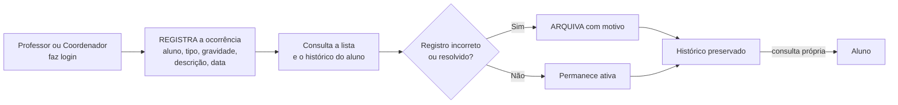
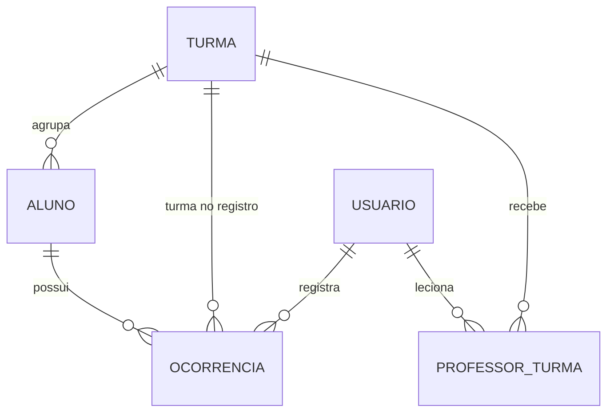
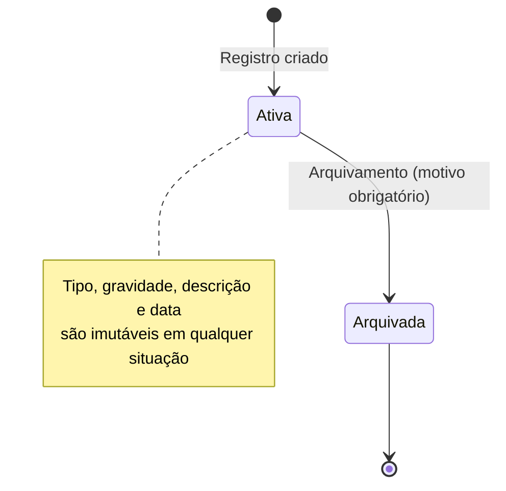
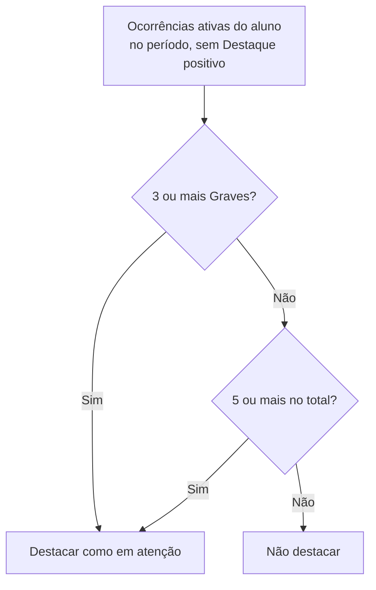

# Requirements.md — Ocorrência+ (Módulo de Ocorrências Disciplinares)

| **Projeto**   | Ocorrência+ — registro digital de ocorrências disciplinares e de destaque |
| ------------- | ------------------------------------------------------------------------- |
| **Versão**    | 2.2                                                                       |
| **Data**      | 14/10/2026                                                                |
| **Autores**   | Enzo e Lucas Rafael                                                       |
| **Atividade** | 3º Bimestre — SPECS (Requirements · Design · Tasks)                       |
| **Status**    | Revisado e limitado ao escopo principal — pronto para a fase de design    |

## Histórico de Revisões

| Versão | Data       | Alterações                                                                                                                                                                                                                                                      |
| ------ | ---------- | --------------------------------------------------------------------------------------------------------------------------------------------------------------------------------------------------------------------------------------------------------------- |
| 1.0    | 18/08/2026 | Versão inicial: registro, arquivamento, listagem e painel de ocorrências.                                                                                                                                                                                       |
| 2.0    | 08/10/2026 | **Revisão do 3º bimestre**: requisitos reordenados a partir do **propósito principal** (registrar ocorrência); painel movido para o final e marcado como complementar; criação de requisitos de autenticação e API testável; lista explícita do que está fora do escopo. |
| 2.1    | 09/10/2026 | **Revisão de consistência**: "Destaque positivo" não conta no critério "em atenção"; imutabilidade garantida também por trigger de `UPDATE` no banco; escopo do professor estendido aos contadores e ao aluno transferido (Req. 4); senha inicial do aluno definida; limite de tentativas de login; nomes de arquivo padronizados. |
| 2.2    | 14/10/2026 | **Revisão final**: correção de erro de digitação no Marco de Entrega; nomes de arquivo padronizados (`Requirements.md`, `Design.md`, `Tasks.md`). |

---

## 1. Propósito Principal

> **O Ocorrência+ existe para REGISTRAR OCORRÊNCIAS.**
> (Assim como a padaria existe para fazer pão, este sistema existe para que um professor ou coordenador registre, em poucos passos, o que aconteceu com um aluno — e para que esse registro nunca se perca nem seja adulterado.)

Tudo neste documento é medido contra essa frase. Um requisito só permanece no escopo se **registrar**, **consultar** ou **proteger** uma ocorrência (ou for pré-requisito direto disso).

### 1.1 Fluxo principal (o que precisa funcionar de ponta a ponta)

### 1.2 Ordem de prioridade

| Prioridade | Grupo                | Requisitos     | O que entrega                                                       |
| :--------: | -------------------- | -------------- | ------------------------------------------------------------------- |
| **1**      | **Núcleo**           | Req. 1 a 4     | Registrar, listar/filtrar, arquivar e consultar histórico           |
| **2**      | Apoio ao núcleo      | Req. 5 e 6     | Login/perfis e cadastro mínimo de turmas, alunos e vínculos         |
| **3**      | Complementar (último)| Req. 7         | Painel simples — **só depois** de o núcleo estar pronto e testado   |

> O painel (dashboard) **não é o ponto de partida** do projeto. A tela inicial do sistema é a lista de ocorrências.

## 2. Introdução

### 2.1 Contexto e Problema

A coordenação escolar registra as ocorrências em cadernos físicos: sem formato padronizado, sem busca e sem garantia de que o registro não será perdido, rasurado ou alterado. Consultar o histórico de um aluno — principalmente quando um responsável está em reunião pedindo explicações — é lento e compromete a credibilidade da coordenação.

### 2.2 Objetivo

Substituir os cadernos por um sistema digital que permita **registrar, consultar e filtrar** ocorrências disciplinares e de destaque com rapidez e confiabilidade, garantindo que nenhum registro seja perdido ou adulterado depois de criado.

### 2.3 Notação

Critérios de aceitação no padrão EARS, adaptado para português:

- **QUANDO** \<evento\> **ENTÃO** o sistema **DEVE** \<comportamento\>
- **SE** \<condição\> **ENTÃO** o sistema **DEVE** \<comportamento\>

### 2.4 Glossário

| Termo                | Definição                                                                                                                                              |
| -------------------- | ------------------------------------------------------------------------------------------------------------------------------------------------------ |
| Ocorrência           | Registro individual e imutável vinculado a um aluno, com tipo, gravidade, descrição, data e a turma do aluno **no momento do registro**.                |
| Situação             | Estado da ocorrência: **ativa** (padrão) ou **arquivada**.                                                                                             |
| Arquivamento         | Transição de "ativa" para "arquivada" com motivo obrigatório. **Não é exclusão**: o conteúdo original continua visível.                                |
| Vínculo Professor↔Turma | Relação que define em quais turmas um professor pode registrar, listar e arquivar ocorrências.                                                     |
| Em atenção           | Aluno que atinge o critério do Req. 7 (volume ou gravidade de ocorrências ativas no período, desconsiderando o tipo "Destaque positivo"). **Uso restrito ao painel complementar.**                 |
| API                  | Backend REST em Node.js que concentra regras de negócio e autorização; é a primeira parte do sistema a ser construída e testada.                       |

## 3. Atores e Perfis de Acesso

| Ator            | Descrição                                                                                                         | Nível de acesso                        |
| --------------- | ----------------------------------------------------------------------------------------------------------------- | -------------------------------------- |
| **Professor**   | Registra, lista e arquiva ocorrências **apenas** das turmas às quais está vinculado                               | Escrita restrita às suas turmas        |
| **Coordenador** | Registra, lista e arquiva ocorrências de **qualquer** turma; cadastra turmas e alunos; vincula professores; transfere alunos | Escrita total + cadastros     |
| **Aluno**       | Consulta **exclusivamente** o próprio histórico                                                                   | Leitura restrita ao próprio registro   |

## 4. Entidades de Domínio

- **Usuário** — pessoa com acesso ao sistema (matrícula, senha, perfil).
- **Turma** — agrupa alunos.
- **Aluno** — vinculado a uma turma; possui um usuário de acesso.
- **Professor↔Turma** — vínculo que define o escopo de turmas do professor.
- **Ocorrência** — registro vinculado a um aluno, com tipo, gravidade, descrição, data e a turma capturada no momento do registro.

---

## 5. Requisitos Funcionais

### GRUPO 1 — NÚCLEO (prioridade máxima)

#### Requisito 1 — Registrar ocorrência

**User Story:** Como professor ou coordenador, eu quero registrar uma ocorrência disciplinar ou de destaque de um aluno em poucos passos, para manter um histórico consultável e confiável do seu comportamento.

**Critérios de Aceitação:**

1. QUANDO o usuário informa aluno, tipo, gravidade, descrição e data ENTÃO o sistema DEVE salvar a ocorrência vinculada ao aluno e à **turma atual do aluno naquele momento**, com situação "ativa", autor e data/hora do registro.
2. O sistema DEVE restringir o campo "tipo" às opções fixas da seção 8 e o campo "gravidade" às opções fixas da seção 8.
3. A descrição DEVE ter de 1 a 500 caracteres e a data da ocorrência NÃO DEVE ser futura.
4. SE algum campo obrigatório estiver ausente ou inválido ENTÃO o sistema DEVE recusar o registro e informar quais campos precisam ser corrigidos.
5. SE o usuário for Professor ENTÃO o sistema DEVE permitir o registro apenas para alunos de turmas às quais ele está vinculado (ver Req. 5).
6. O sistema NÃO DEVE permitir a exclusão de nenhuma ocorrência registrada.
7. O sistema NÃO DEVE permitir a edição de tipo, gravidade, descrição ou data após o registro. Uma correção DEVE ser feita por **nova ocorrência**, que pode referenciar a anterior, ou pelo **arquivamento** (Req. 3).
8. QUANDO o registro é concluído ENTÃO o sistema DEVE confirmar o sucesso ao usuário e a ocorrência DEVE aparecer imediatamente na listagem.

#### Requisito 2 — Listar e filtrar ocorrências

**User Story:** Como professor ou coordenador, eu quero listar ocorrências filtrando por aluno, turma, período, tipo e gravidade, para responder rapidamente aos responsáveis em reunião.

**Critérios de Aceitação:**

1. QUANDO o usuário acessa a listagem ENTÃO o sistema DEVE exibir, por padrão, as ocorrências **ativas**, da mais recente para a mais antiga, de forma paginada.
2. O sistema DEVE permitir alternar a visualização entre **ativas**, **arquivadas** e **todas**.
3. O sistema DEVE permitir filtrar por aluno (nome ou matrícula), turma, período (data inicial e final), tipo e gravidade, isoladamente ou combinados.
4. SE nenhum resultado atender aos filtros ENTÃO o sistema DEVE informar que não há ocorrências para os critérios selecionados.
5. O professor DEVE visualizar somente ocorrências de turmas às quais está vinculado; o coordenador visualiza as de todas as turmas.
6. Cada item da listagem DEVE exibir aluno, turma registrada, tipo, gravidade, data, descrição e situação; se arquivada, DEVE exibir também o motivo, o autor e a data do arquivamento.

#### Requisito 3 — Arquivar ocorrência

**User Story:** Como professor ou coordenador, eu quero arquivar uma ocorrência registrada incorretamente ou já resolvida, mantendo o histórico original visível, para preservar a integridade dos registros sem perder rastreabilidade.

**Critérios de Aceitação:**

1. QUANDO o usuário arquiva uma ocorrência ENTÃO o sistema DEVE exigir um motivo em texto (1 a 500 caracteres).
2. QUANDO uma ocorrência é arquivada ENTÃO o sistema DEVE manter tipo, gravidade, descrição e data intactos e visíveis, marcados como arquivada.
3. QUANDO uma ocorrência é arquivada ENTÃO o sistema DEVE registrar autor, data/hora e motivo, para fins de auditoria.
4. SE o usuário for Professor ENTÃO o sistema DEVE permitir o arquivamento apenas de ocorrências cuja turma registrada seja uma de suas turmas vinculadas.
5. O sistema DEVE permitir que o coordenador arquive qualquer ocorrência.
6. SE a ocorrência já estiver arquivada ENTÃO o sistema DEVE recusar um novo arquivamento.

#### Requisito 4 — Consultar o histórico do aluno

**User Story:** Como professor, coordenador ou aluno, eu quero consultar o histórico de ocorrências de um aluno, para acompanhar sua situação disciplinar.

**Critérios de Aceitação:**

1. QUANDO professor ou coordenador seleciona um aluno ENTÃO o sistema DEVE exibir seu histórico de ocorrências (ativas por padrão, com opção de arquivadas), com filtros por tipo, gravidade e período.
2. O histórico DEVE exibir, em cada ocorrência, a **turma registrada no momento do registro**, mesmo que o aluno tenha mudado de turma depois.
3. O professor DEVE visualizar apenas as ocorrências cuja turma registrada seja uma de suas turmas vinculadas.
4. QUANDO um aluno autenticado acessa seu histórico ENTÃO o sistema DEVE exibir somente as suas próprias ocorrências.
5. SE um aluno tentar acessar o histórico de outro aluno (ex.: alterando um identificador) ENTÃO o sistema DEVE negar o acesso.
6. Os contadores e resumos exibidos a um professor (ex.: total de ocorrências ativas de um aluno) DEVEM considerar **apenas** ocorrências de turmas às quais ele está vinculado.
7. SE um aluno foi transferido para uma turma não vinculada ao professor, mas possui ocorrências registradas em turma vinculada a ele, ENTÃO o professor DEVE conseguir consultar o histórico desse aluno, vendo **somente** as ocorrências de suas turmas vinculadas.

---

### GRUPO 2 — APOIO AO NÚCLEO

#### Requisito 5 — Autenticação e perfis de acesso

**User Story:** Como sistema, eu preciso identificar o usuário e diferenciar as permissões de professor, coordenador e aluno, para que cada um realize apenas as ações permitidas ao seu perfil.

**Critérios de Aceitação:**

1. QUANDO o usuário informa matrícula e senha válidas ENTÃO o sistema DEVE autenticá-lo e identificar seu perfil.
2. SE a matrícula ou a senha forem inválidas ENTÃO o sistema DEVE recusar o acesso com mensagem genérica, sem indicar qual dos dois está incorreto.
3. SE uma requisição não estiver autenticada ENTÃO o sistema DEVE recusá-la.
4. O sistema DEVE permitir que Professor e Coordenador registrem, listem e arquivem ocorrências, respeitando a restrição de turma do professor.
5. O sistema DEVE permitir que o perfil Aluno apenas visualize o próprio histórico, sem acesso a registro, arquivamento ou cadastros.
6. O sistema DEVE aplicar todas as restrições de perfil e de turma **no backend**, em cada requisição, e não apenas ocultando botões na interface.
7. O sistema DEVE permitir que **apenas o Coordenador** cadastre turmas, alunos e vínculos e transfira alunos.

#### Requisito 6 — Cadastro mínimo de turmas, alunos e vínculos

**User Story:** Como coordenador, eu quero cadastrar turmas e alunos e vincular professores às turmas, para que as ocorrências possam ser corretamente atribuídas a cada aluno e restringidas a cada professor.

**Critérios de Aceitação:**

1. QUANDO o coordenador cadastra uma turma informando um nome ENTÃO o sistema DEVE salvá-la; SE o nome já existir ENTÃO DEVE impedir o cadastro duplicado.
2. QUANDO o coordenador cadastra um aluno informando nome, matrícula e turma ENTÃO o sistema DEVE salvá-lo e criar seu acesso ao sistema; SE a matrícula já existir ENTÃO DEVE recusar o cadastro.
3. QUANDO o coordenador vincula um professor a uma turma ENTÃO o sistema DEVE permitir que esse professor registre, liste e arquive ocorrências dessa turma a partir desse momento.
4. SE um professor não estiver vinculado a uma turma ENTÃO o sistema DEVE impedir que ele registre, liste ou arquive ocorrências dessa turma.
5. QUANDO o coordenador transfere um aluno para outra turma ENTÃO o sistema DEVE atualizar a turma atual do aluno e DEVE preservar, sem alteração, a turma registrada nas ocorrências já existentes.

---

### GRUPO 3 — COMPLEMENTAR (implementar por último)

#### Requisito 7 — Painel simples e alunos em atenção

> **Condição de entrega:** este requisito só deve ser implementado **depois** de os Requisitos 1 a 6 estarem concluídos e testados. Não faz parte do ponto de partida do projeto.

**User Story:** Como coordenador, eu quero visualizar o total de ocorrências por turma e identificar alunos que demandam atenção, para agir preventivamente antes da reunião com os responsáveis.

**Critérios de Aceitação:**

1. O sistema DEVE exibir, por turma, o total de ocorrências **ativas** no período selecionado, com distribuição por tipo e por gravidade.
2. QUANDO um aluno tiver **3 ou mais** ocorrências ativas de gravidade Grave, **OU 5 ou mais** ocorrências ativas de qualquer gravidade, dentro do período (padrão: últimos 30 dias) ENTÃO o sistema DEVE destacá-lo como "em atenção".
3. O sistema DEVE permitir ajustar a janela do período (30, 60 ou 90 dias).
4. Ocorrências arquivadas NÃO DEVEM ser contabilizadas em nenhum indicador. Ocorrências do tipo **Destaque positivo** aparecem na distribuição por tipo (item 1), mas NÃO DEVEM ser contabilizadas no critério de "em atenção" (item 2).
5. O painel DEVE ser acessível somente ao Coordenador.

---

## 6. Requisitos Não Funcionais

| #    | Requisito                    | Descrição                                                                                                                                                                       |
| ---- | ---------------------------- | ------------------------------------------------------------------------------------------------------------------------------------------------------------------------------- |
| RNF1 | Integridade histórica        | Nenhuma ocorrência pode ser fisicamente excluída nem ter seu conteúdo alterado; a garantia deve existir na API **e** no próprio banco de dados (triggers que bloqueiam `DELETE` e `UPDATE` dos campos de conteúdo), não apenas na aplicação.                                          |
| RNF2 | Auditoria                    | Todo arquivamento registra autor, data/hora e motivo.                                                                                                                           |
| RNF3 | Controle de acesso           | Perfil e vínculo Professor↔Turma são verificados em toda requisição à API, nunca apenas na interface.                                                                           |
| RNF4 | Usabilidade da consulta      | Listagem e histórico devem responder rápido o suficiente para uso durante uma reunião com responsáveis (consulta pontual; não é requisito de alta carga).                          |
| RNF5 | API testável                 | O sistema possui um **backend em API REST (Node.js)**; cada rota deve poder ser testada isoladamente, sem a interface, por uma ferramenta HTTP (arquivo `.http`, Thunder Client, Insomnia ou Postman), com respostas JSON e códigos HTTP padronizados. |
| RNF6 | Padronização de erros        | Todas as falhas retornam um formato único de erro (código, mensagem e detalhes por campo quando houver).                                                                        |
| RNF7 | Segurança básica             | Senhas armazenadas com hash; sessão por token com expiração; validação de toda entrada; segredos em variáveis de ambiente; limite de tentativas no login.                                                      |
| RNF8 | Privacidade                  | Por envolver dados de estudantes (muitos menores), aplica-se o princípio do menor privilégio (RNF3). Política formal de LGPD está fora do escopo deste bimestre, registrada como ponto de atenção. |

## 7. Rastreabilidade: Regras de Negócio → Requisitos

| Regra de Negócio                                                                                                  | Requisito(s)                                          |
| ----------------------------------------------------------------------------------------------------------------- | ----------------------------------------------------- |
| RN1 — Ocorrência é imutável e nunca é excluída; só pode ser arquivada com motivo, mantendo o original visível      | Req. 1 (6–7); Req. 3 (1–3); RNF1; RNF2                |
| RN2 — Aluno vê só o próprio histórico                                                                              | Req. 4 (4–5); Req. 5 (5)                              |
| RN3 — Professor só registra, lista ou arquiva ocorrências de turmas às quais está vinculado                        | Req. 1 (5); Req. 2 (5); Req. 3 (4); Req. 4 (3, 6, 7); Req. 5 (4, 6); Req. 6 (3–4) |
| RN4 — Aluno com volume/gravidade relevante é destacado como "em atenção" (**complementar**)                        | Req. 7                                                |
| RN5 — A turma da ocorrência é a do momento do registro; transferência posterior não a altera                       | Req. 1 (1); Req. 4 (2); Req. 6 (5)                    |

## 8. Listas Fixas (Enumerações)

**Tipo de Ocorrência:** Atraso · Indisciplina · Uso indevido de celular · Dano ao patrimônio · Destaque positivo

**Gravidade:** Leve · Média · Grave

**Situação da ocorrência:** Ativa · Arquivada

## 9. Fora de Escopo (não será feito neste bimestre)

**Do briefing original:**
- Chamada, presença e cálculo de frequência por aula.
- QR code, biometria ou catraca.
- Upload de atestado médico.
- Portal do responsável e **qualquer aviso automático para a família**.
- Notas, boletim e cálculo de aprovação.
- Edição de dados cadastrais de Turma e Aluno após o cadastro inicial (a única alteração permitida é a transferência de turma).
- Política formal de privacidade/LGPD.
- Troca e recuperação de senha pelo usuário (limitação conhecida).
- Definição de interface e fluxos de tela (tratado no `Design.md`).

**Removidos nesta revisão por não pertencerem ao propósito principal** (podem voltar em uma evolução futura):
- Fluxo de status do caso (Pendente → Em análise → Resolvido); nesta fase existe apenas ativa/arquivada.
- Painel com KPIs de casos pendentes/resolvidos e alertas críticos.
- Categorias de ocorrência além dos 5 tipos fixos (ex.: Falta, Agressão, Bullying).
- Situação do aluno Regular/Atenção/Crítico em listas (o único destaque é o "em atenção" do Req. 7).
- Anexos de arquivos na ocorrência.
- Notificação de responsáveis e central de notificações (sino).
- Exportação de relatórios e de listas.
- Filtro por turno (manhã/tarde).
- "Manter conectado" e "Esqueci minha senha" no login.
- Telas de cadastro de professores e coordenadores (esses usuários são criados por script de carga inicial).

## 10. Premissas e Pontos em Aberto

1. **Autenticação**: o briefing não detalha o mecanismo. Assume-se **login por matrícula e senha**, com token de sessão. Recuperação de senha está fora do escopo.
2. **Critério "em atenção"** (3 graves **ou** 5 no total, em 30 dias) é uma premissa dos autores; confirmar com o professor orientador antes de implementar o Req. 7.
3. **Cadastros** são atribuídos ao Coordenador; se o professor também precisar cadastrar, ajustar os Req. 5 e 6.
4. **Edição de ocorrência** não é permitida (apenas arquivamento) — decisão de simplicidade e rastreabilidade. Se o projeto exigir edição, é uma mudança pontual no Req. 1.
5. **Vínculo do professor no arquivamento**: usa-se a **turma registrada na ocorrência**, não a turma atual do aluno (consequência direta da RN5).
6. **Arquivamento definitivo**: nesta fase não existe "desarquivar".
7. **Usuários professor e coordenador** são criados por script de carga inicial (seed); **alunos** ganham acesso automaticamente ao serem cadastrados, com senha inicial provisória igual à matrícula (decisão válida apenas para o ambiente acadêmico). A troca de senha pelo usuário está fora do escopo e fica registrada como limitação conhecida (ver RNF7).
8. **"Destaque positivo"** segue o mesmo fluxo das demais ocorrências (inclusive a exigência de gravidade); por não ser um problema disciplinar, **não é contabilizado** no critério "em atenção" (Req. 7).

## 11. Marco de Entrega do Núcleo

O núcleo (Req. 1 a 6) é considerado entregue quando, **pela API e depois pela interface**, for possível:

1. Entrar com matrícula e senha.
2. Registrar uma ocorrência para um aluno.
3. Listar e filtrar as ocorrências.
4. Arquivar uma ocorrência informando o motivo, vendo o original preservado.
5. Consultar o histórico do aluno e, como aluno, o próprio histórico.
6. Comprovar que professor sem vínculo recebe acesso negado e que editar/excluir uma ocorrência é recusado.