# Tasks.md — Ocorrência+ (Módulo de Ocorrências Disciplinares)

| **Versão**     | 1.2                                                      |
| -------------- | -------------------------------------------------------- |
| **Data**       | 14/10/2026                                               |
| **Autores**    | Enzo e Lucas Rafael                                      |
| **Baseado em** | `Requirements.md` v2.2 · `Design.md` v3.1                |
| **Atividade**  | 3º Bimestre — SPECS (Requirements · Design · Tasks)      |

> **v1.2 (14/10/2026):** Tarefa 1.1 com `routes/index.js` e todas as rotas simuladas R01–R10; seeders de desenvolvimento explicitam a senha dos alunos; nome do arquivo padronizado (`Tasks.md`).
>
> **v1.1 (09/10/2026):** trigger de `UPDATE` no banco (1.2, 1.9); escopo do professor nos contadores e no aluno transferido (1.7); senha inicial do aluno = matrícula (1.8); limite de tentativas no login (1.3); "Destaque positivo" fora do critério "em atenção" (3.1); Express 5, Node 22 LTS, Tailwind v4 e React 19 considerados (1.3, 2.1).
>
---

## 1. Como ler este plano

> **Propósito principal:** o Ocorrência+ existe para **REGISTRAR OCORRÊNCIAS**. As tarefas seguem essa ordem: primeiro a API que registra, depois a tela que registra. O painel (dashboard) é a **última** coisa do plano.

**Regras de ordem (não negociáveis):**

1. **Backend antes do frontend.** Nenhuma tela é iniciada antes do checkpoint da **Tarefa 1.10**.
2. **A primeira tarefa são as rotas testáveis** (Tarefa 1.1): o contrato da API é criado e testado antes de banco, regras ou telas.
3. **Núcleo antes de apoio, apoio antes de complementar.** O painel (Req. 7) só começa depois de a Tarefa 2.11 estar concluída.
4. **Nada fora do escopo.** Se uma ideia não está no `Requirements.md`, ela não vira tarefa (ver §9 do Requirements).
5. **Código só onde há tarefa que o peça.** Os trechos deste arquivo são **referência**, no tamanho do que a tarefa precisa.

**Legenda de esforço:** P (até meio dia) · M (1 dia) · G (2 dias ou mais)

---

## 2. Visão geral das tarefas

### FASE 1 — BACKEND (API Node.js + Express + PostgreSQL + Sequelize)

- [x] **1.1** Projeto Express + **rotas do núcleo testáveis** (respostas simuladas) + `api.http` — _P/M_ — **PRIMEIRA TAREFA**
- [ ] **1.2** PostgreSQL + Sequelize: conexão, modelos, migrations, trigger e seeds — _M_
- [ ] **1.3** Autenticação real e middlewares (R02, R03) — _M_
- [ ] **1.4** **Registrar ocorrência** de verdade (R04) — _M_
- [ ] **1.5** Listar e detalhar ocorrências com filtros e paginação (R05, R06) — _M_
- [ ] **1.6** Arquivar ocorrência e bloquear edição/exclusão (R07, R08) — _M_
- [ ] **1.7** Histórico do aluno, visão do aluno e leituras de apoio (R09, R10, R11, R12, R13) — _M_
- [ ] **1.8** Cadastros: turmas, alunos, vínculos e transferência (R14 a R19) — _M_
- [ ] **1.9** Testes automatizados do backend (Jest + Supertest) — _M/G_
- [ ] **1.10** **Checkpoint do backend** — _P_ — libera o frontend

### FASE 2 — FRONTEND (React)

- [ ] **2.1** Projeto React + Vite + Tailwind + Router + cliente HTTP — _P_
- [ ] **2.2** Componentes base (`ui`) — _M_
- [ ] **2.3** `AuthContext`, `ProtectedRoute` e **LoginPage** — _M_
- [ ] **2.4** Layout: `AppHeader`, abas por perfil e mapa de rotas — _P/M_
- [ ] **2.5** **OcorrenciasPage**: lista, abas de situação, filtros e paginação — _M/G_
- [ ] **2.6** **RegistrarOcorrenciaDrawer** (registrar pela interface) — _M/G_
- [ ] **2.7** Arquivar ocorrência e ver detalhes — _M_
- [ ] **2.8** **AlunosPage** (painel lateral) e **FichaAlunoPage** — _M/G_
- [ ] **2.9** **CadastrosPage**: turmas, alunos, vínculos e transferência — _M_
- [ ] **2.10** **MeuHistoricoPage** (perfil aluno) — _P_
- [ ] **2.11** Testes do frontend, roteiro ponta a ponta e ajustes — _M_

### FASE 3 — COMPLEMENTAR (somente após a Tarefa 2.11)

- [ ] **3.1** Backend do painel simples (R20, R21) — _M_
- [ ] **3.2** Frontend: **PainelPage** — _M_

### FASE 4 — FECHAMENTO

- [ ] **4.1** README, roteiro de demonstração e revisão final dos 3 arquivos — _P/M_

### Mapa de dependências

```mermaid
flowchart LR
    T11[1.1 Rotas testáveis] --> T12[1.2 Banco + modelos]
    T12 --> T13[1.3 Autenticação]
    T13 --> T14[1.4 Registrar]
    T14 --> T15[1.5 Listar]
    T15 --> T16[1.6 Arquivar]
    T16 --> T17[1.7 Histórico + apoio]
    T17 --> T18[1.8 Cadastros]
    T18 --> T19[1.9 Testes backend]
    T19 --> T110{{1.10 Checkpoint}}
    T110 --> T21[2.1 Setup React]
    T21 --> T22[2.2 Componentes]
    T22 --> T23[2.3 Login]
    T23 --> T24[2.4 Layout]
    T24 --> T25[2.5 Lista]
    T25 --> T26[2.6 Drawer registrar]
    T26 --> T27[2.7 Arquivar]
    T27 --> T28[2.8 Alunos + ficha]
    T28 --> T29[2.9 Cadastros]
    T29 --> T210[2.10 Meu histórico]
    T210 --> T211[2.11 Testes + E2E]
    T211 --> T31[3.1 Painel API]
    T31 --> T32[3.2 Painel UI]
    T32 --> T41[4.1 Fechamento]
```



---

# FASE 1 — BACKEND

## Tarefa 1.1 — Projeto Express + rotas do núcleo testáveis  ⭐ PRIMEIRA TAREFA ✅ CONCLUÍDA

**Objetivo:** ter uma API no ar em que **todas as rotas do núcleo já respondem** conforme o contrato do `Design.md` (seção 3), com dados simulados, e que possam ser testadas por uma ferramenta HTTP — antes de existir banco, regra de negócio ou tela.

**Requisitos:** RNF5, RNF6 · **Rotas:** R01 a R10 (simuladas) · **Depende de:** —

**Passos**

1. Criar a pasta `backend/`, inicializar o projeto e instalar as dependências.
2. Criar `src/app.js` (Express, `cors`, `express.json()`, rotas em `/api`, tratador de erros no formato único) e `src/server.js`.
3. Criar `src/utils/ErroApp.js` e `src/middlewares/erros.js` (formato `{ codigo, mensagem, detalhes }`).
4. Criar `src/routes/index.js` e `src/routes/ocorrencias.routes.js` com as rotas R01 a R10 e **respostas simuladas** que respeitem o formato do Design (inclusive os erros `401`, `403`, `404` e `405` mais óbvios).
5. Criar `backend/api.http` com uma requisição por rota (modelo na seção 3.11 do Design).
6. Testar **cada rota** com o checklist do Design (feliz, sem token, perfil errado, entrada inválida, inexistente).

**Código de referência**

```bash
mkdir ocorrencia-mais && cd ocorrencia-mais
mkdir backend && cd backend
npm init -y
npm install express cors dotenv sequelize pg pg-hstore jsonwebtoken bcryptjs joi express-rate-limit
npm install -D nodemon sequelize-cli jest supertest
```

```js
// src/app.js
const express = require('express');
const cors = require('cors');
const rotas = require('./routes');
const tratarErros = require('./middlewares/erros');

const app = express();
app.use(cors());
app.use(express.json());
app.use('/api', rotas);
app.use(tratarErros);

module.exports = app;
```

```js
// src/utils/ErroApp.js
class ErroApp extends Error {
  constructor(status, codigo, mensagem, detalhes) {
    super(mensagem);
    this.status = status;
    this.codigo = codigo;
    this.detalhes = detalhes;
  }
}
module.exports = ErroApp;
```

```js
// src/middlewares/erros.js
module.exports = (erro, req, res, next) => {
  if (erro.status) {
    return res.status(erro.status).json({ codigo: erro.codigo, mensagem: erro.message, detalhes: erro.detalhes });
  }
  console.error(erro);
  return res.status(500).json({ codigo: 'ERRO_INTERNO', mensagem: 'Erro inesperado.' });
};
```

```js
// src/routes/index.js — VERSÃO SIMULADA (cada grupo é trocado pela versão real nas tarefas 1.3 a 1.8)
const router = require('express').Router();

router.get('/health', (req, res) => res.json({ status: 'ok' }));                                    // R01

router.post('/auth/login', (req, res) => res.json({                                                // R02
  token: 'token-simulado',
  usuario: { id: 'e9b0c1d2-0000-4000-8000-000000000001', nome: 'Verônica Lima', matricula: '2026000001', perfil: 'coordenador' },
}));
router.get('/auth/me', (req, res) => res.json({                                                    // R03
  id: 'e9b0c1d2-0000-4000-8000-000000000001', nome: 'Verônica Lima', matricula: '2026000001', perfil: 'coordenador',
}));

router.use('/ocorrencias', require('./ocorrencias.routes'));                                       // R04 a R08

router.get('/alunos/:id/ocorrencias', (req, res) =>                                                // R09
  res.json({ aluno: { id: req.params.id, nome: 'Ana Clara Silva', turmaAtual: { nome: '8º A' } }, itens: [], total: 0, page: 1, pageSize: 10 }));
router.get('/me/ocorrencias', (req, res) =>                                                        // R10
  res.json({ itens: [], total: 0, page: 1, pageSize: 10 }));

module.exports = router;
```

```js
// src/routes/ocorrencias.routes.js — VERSÃO SIMULADA (será trocada nas tarefas 1.4 a 1.6)
const router = require('express').Router();

const ocorrenciaExemplo = {
  id: '7a2e9c44-51b3-4f6e-8c2d-0e3f6a1b9d55',
  aluno: { id: '0f5c3b1e-8d7a-4f0a-9d7e-2a6c1b9e4a10', nome: 'Ana Clara Silva', matricula: '2026010101' },
  turma: { id: 'c3a1d2f4-0000-4000-8000-000000000001', nome: '8º A' },
  tipo: 'uso_indevido_celular',
  gravidade: 'leve',
  descricao: 'Utilizou o celular durante a aula.',
  data: '2026-05-12',
  arquivada: false,
  arquivamento: null,
  referenciaId: null,
  criadoPor: { id: 'e9b0c1d2-0000-4000-8000-000000000002', nome: 'Prof. Marcos Andrade' },
  criadoEm: '2026-05-12T14:03:21.000Z',
};

router.post('/', (req, res) => res.status(201).json(ocorrenciaExemplo));                              // R04
router.get('/', (req, res) => res.json({ itens: [ocorrenciaExemplo], total: 1, page: 1, pageSize: 10 })); // R05
router.get('/:id', (req, res) => res.json(ocorrenciaExemplo));                                         // R06
router.post('/:id/arquivamento', (req, res) =>                                                         // R07
  res.json({ ...ocorrenciaExemplo, arquivada: true, arquivamento: { motivo: req.body.motivo, por: { nome: 'Verônica Lima' }, em: new Date().toISOString() } }));
router.all('/:id', (req, res) =>                                                                       // R08
  res.status(405).json({ codigo: 'METODO_NAO_PERMITIDO', mensagem: 'Ocorrências não podem ser editadas ou excluídas. Registre uma nova ocorrência ou arquive esta.' }));

module.exports = router;
```

**Pronto quando**

- [ ] `npm run dev` sobe a API na porta 3333 e `GET /api/health` responde `200`.
- [ ] R01 a R10 respondem com o formato do Design e os códigos HTTP corretos.
- [ ] `PATCH` e `DELETE` em `/api/ocorrencias/:id` retornam `405` com a mensagem do Design.
- [ ] `backend/api.http` existe e cada requisição foi executada com sucesso.

---

## Tarefa 1.2 — PostgreSQL + Sequelize

**Objetivo:** persistir os dados reais com as constraints que garantem as regras (RN1, RN5).

**Requisitos:** RNF1 · **Depende de:** 1.1

**Passos**

1. Criar o banco `ocorrencia_mais` (e `ocorrencia_mais_test` para os testes) no PostgreSQL.
2. Configurar `.env` (modelo no Design §3.12), `config/database.js` e `.sequelizerc` apontando para `src/database/migrations` e `src/database/seeders`.
3. Criar os modelos `Usuario`, `Turma`, `Aluno`, `ProfessorTurma` e `Ocorrencia` e as associações (modelos no Design §3.7; a `Ocorrencia` **com os hooks de imutabilidade**).
4. Criar as migrations das 5 tabelas (UUID, ENUMs, FKs, `UNIQUE` em `usuarios.matricula`, `turmas.nome` e `alunos.matricula`, índices do Design §3.6).
5. Criar os seeders (dados de desenvolvimento, abaixo). Eles usam senhas fracas e **não devem rodar em produção** (proteger com `NODE_ENV`).
6. Atualizar `GET /api/health` para testar a conexão (`sequelize.authenticate()`).

> Decisão (ver Design §3.6): sem triggers de banco nesta etapa — a imutabilidade de `ocorrencias` é garantida só pelos hooks do modelo Sequelize (`beforeUpdate`/`beforeDestroy`).

**Código de referência**

```js
// .sequelizerc
const path = require('path');
module.exports = {
  config: path.resolve('src', 'config', 'database.js'),
  'migrations-path': path.resolve('src', 'database', 'migrations'),
  'seeders-path': path.resolve('src', 'database', 'seeders'),
};
```

```js
// src/database/migrations/2026100801-criar-ocorrencias.js (trecho)
module.exports = {
  async up(queryInterface, Sequelize) {
    await queryInterface.createTable('ocorrencias', {
      id: { type: Sequelize.UUID, primaryKey: true, defaultValue: Sequelize.UUIDV4 },
      aluno_id: { type: Sequelize.UUID, allowNull: false, references: { model: 'alunos', key: 'id' } },
      turma_id: { type: Sequelize.UUID, allowNull: false, references: { model: 'turmas', key: 'id' } },
      tipo: { type: Sequelize.ENUM('atraso', 'indisciplina', 'uso_indevido_celular', 'dano_patrimonio', 'destaque_positivo'), allowNull: false },
      gravidade: { type: Sequelize.ENUM('leve', 'media', 'grave'), allowNull: false },
      descricao: { type: Sequelize.STRING(500), allowNull: false },
      data_ocorrencia: { type: Sequelize.DATEONLY, allowNull: false },
      criado_por: { type: Sequelize.UUID, allowNull: false, references: { model: 'usuarios', key: 'id' } },
      criado_em: { type: Sequelize.DATE, allowNull: false, defaultValue: Sequelize.fn('NOW') },
      arquivada: { type: Sequelize.BOOLEAN, allowNull: false, defaultValue: false },
      motivo_arquivamento: { type: Sequelize.STRING(500) },
      arquivado_por: { type: Sequelize.UUID, references: { model: 'usuarios', key: 'id' } },
      arquivado_em: { type: Sequelize.DATE },
      referencia_id: { type: Sequelize.UUID, references: { model: 'ocorrencias', key: 'id' } },
    });
    await queryInterface.addIndex('ocorrencias', ['aluno_id', 'data_ocorrencia']);
    await queryInterface.addIndex('ocorrencias', ['turma_id', 'data_ocorrencia']);
  },
  async down(queryInterface) {
    await queryInterface.dropTable('ocorrencias');
  },
};
```

```bash
npx sequelize-cli db:migrate
npx sequelize-cli db:seed:all
```

**Dados de desenvolvimento (seeders)** — senha de **todos** os usuários: `senha123` (apenas desenvolvimento). Os alunos criados pela rota R15 (Tarefa 1.8) seguem a regra real: senha inicial = matrícula.

| Matrícula     | Nome                  | Perfil       | Observação                                  |
| ------------- | --------------------- | ------------ | ------------------------------------------- |
| `2026000001`  | Verônica Lima         | coordenador  | —                                           |
| `2026000002`  | Prof. Marcos Andrade  | professor    | vinculado às turmas **8º A** e **9º B**     |
| `2026000003`  | Profa. Helena Souza   | professor    | vinculada à turma **7º C**                  |
| `2026010101`…`2026010107` | Ana Clara Silva, Bruno Alves Lima, Daniela Rocha Torres, Eduardo Pires Santos, Fernanda Lopes Dias, Lucas Gabriel Oliveira, Mateus Costa Ribeiro | aluno | todos na turma **8º A** |
| `2026020101`, `2026030101` | 1 aluno no 9º B e 1 aluno no 7º C | aluno | para testar o isolamento entre turmas |

**Pronto quando**

- [ ] `db:migrate` cria as 5 tabelas sem erro; `db:migrate:undo:all` desfaz.
- [ ] `db:seed:all` cria os dados acima.
- [ ] Alterar uma ocorrência com `instancia.save()` fora dos campos de arquivamento lança `OCORRENCIA_IMUTAVEL`; `instancia.destroy()` lança `OCORRENCIA_NAO_PODE_SER_EXCLUIDA` (hooks do modelo, sem trigger de banco — ver Design §3.6).
- [ ] `GET /api/health` mostra `"banco": "conectado"`.

---

## Tarefa 1.3 — Autenticação real e middlewares

**Objetivo:** identificar o usuário e o perfil em toda requisição (RNF3, Req. 5).

**Requisitos:** Req. 5 (1–3, 6) · **Rotas:** R02, R03 · **Depende de:** 1.2

**Passos**

1. Implementar `POST /api/auth/login`: buscar usuário pela matrícula, comparar com `bcrypt.compare`, gerar JWT (`sub`, `perfil`, expiração de 8 h). Aplicar `express-rate-limit` nesta rota (ex.: 10 tentativas a cada 15 minutos → `429 MUITAS_TENTATIVAS`).
2. Implementar `GET /api/auth/me`.
3. Criar `middlewares/autenticar.js` e `middlewares/autorizarPerfil.js` (Design §3.8) e `middlewares/validar.js` (executa o esquema Joi e devolve `400 VALIDACAO` com `detalhes` por campo).
4. Aplicar `autenticar` em todas as rotas, exceto R01 e R02.
5. Atualizar o `api.http` com o login real e a variável `@token`.

**Código de referência**

```js
// src/controllers/auth.controller.js (trecho)
async function login(req, res) {
  const { matricula, senha } = req.body;
  const usuario = await Usuario.findOne({ where: { matricula } });
  const senhaOk = usuario && (await bcrypt.compare(senha, usuario.senhaHash));
  if (!senhaOk) throw new ErroApp(401, 'CREDENCIAIS_INVALIDAS', 'Matrícula ou senha inválidos.');

  const token = jwt.sign({ perfil: usuario.perfil }, process.env.JWT_SECRET, {
    subject: usuario.id,
    expiresIn: process.env.JWT_EXPIRES_IN,
  });
  res.json({ token, usuario: { id: usuario.id, nome: usuario.nome, matricula: usuario.matricula, perfil: usuario.perfil } });
}
```

> No Express 5 (instalado por padrão), erros em rotas `async` já chegam ao tratador de erros. Se fixar o Express 4, use um _wrapper_ `asyncHandler` ou o pacote `express-async-errors`.

**Pronto quando**

- [ ] Login com `2026000001`/`senha123` devolve token e usuário; senha errada devolve `401` com a **mesma** mensagem de matrícula inexistente.
- [ ] Qualquer rota protegida sem token devolve `401 NAO_AUTENTICADO`.
- [ ] `GET /api/auth/me` devolve o usuário do token.
- [ ] A senha **nunca** aparece em nenhuma resposta.
- [ ] Após exceder o limite de tentativas, o login responde `429`.

---

## Tarefa 1.4 — Registrar ocorrência (a rota mais importante)

**Objetivo:** substituir a simulação de R04 pela implementação real: **registrar uma ocorrência**.

**Requisitos:** Req. 1 (1–5, 8), RN3, RN5 · **Rota:** R04 · **Depende de:** 1.3

**Passos**

1. Criar `services/escopo.service.js` (`turmasPermitidas`, `podeAgirNaTurma`) — Design §3.8.
2. Criar o esquema Joi `esquemaRegistro` — Design §3.8.
3. Criar `services/ocorrencia.service.js` → `registrar(usuario, dados)` — Design §3.8: valida existência do aluno, verifica vínculo, **captura `turmaId` do aluno**, grava `criadoPor` a partir do token.
4. Se vier `referenciaId`, validar que existe e é do **mesmo aluno** (`404`/`400`).
5. Montar a resposta no formato da R04 (incluir `aluno`, `turma`, `criadoPor`).
6. Testar no `api.http`: caminho feliz, descrição vazia, descrição com 501 caracteres, data futura, tipo inexistente, **professor sem vínculo → 403**, aluno tentando registrar → 403.

**Pronto quando**

- [ ] Registrar como **coordenador** em qualquer aluno retorna `201` e a linha existe no banco com `turma_id` igual à turma do aluno **naquele momento**.
- [ ] Registrar como **Prof. Marcos** em aluno do 8º A funciona; em aluno do **7º C** retorna `403`.
- [ ] Todos os erros de validação voltam no formato único com `detalhes` por campo.
- [ ] `criadoPor` enviado no body é **ignorado**.

---

## Tarefa 1.5 — Listar e detalhar ocorrências

**Objetivo:** consultar as ocorrências registradas, com filtros e paginação.

**Requisitos:** Req. 2 · **Rotas:** R05, R06 · **Depende de:** 1.4

**Passos**

1. Implementar `listar(usuario, query)`: `situacao` (padrão `ativas`), `q` (nome ou matrícula do aluno, `iLike`), `turmaId`, `tipo`, `gravidade`, `dataInicio`/`dataFim`, `page`, `pageSize` (máx. 50).
2. Aplicar o **escopo**: professor só vê `turmaId IN (turmasPermitidas)`; `turmaId` de turma não vinculada → `403`.
3. Ordenar por `dataOcorrencia DESC, criadoEm DESC`; usar `findAndCountAll` com `include` de aluno, turma e autor.
4. Implementar `detalhar(usuario, id)`: `404` se inexistente; `403` se professor sem vínculo com a turma registrada ou se aluno não for o titular; incluir `arquivamento` quando arquivada.
5. Padronizar a saída em uma função `serializarOcorrencia()` (formato do Design R04/R06), reaproveitada nas próximas tarefas.

**Pronto quando**

- [ ] Sem filtros, retorna só **ativas**, da mais recente para a mais antiga, com `total`, `page` e `pageSize`.
- [ ] Combinar `tipo` + `gravidade` + período + `q` funciona.
- [ ] Lista vazia retorna `200` com `itens: []`.
- [ ] Professor nunca recebe ocorrência de turma não vinculada.

---

## Tarefa 1.6 — Arquivar ocorrência e bloquear edição/exclusão

**Objetivo:** corrigir sem apagar e **provar** que o histórico não é adulterado.

**Requisitos:** Req. 1 (6–7), Req. 3, RN1 · **Rotas:** R07, R08 · **Depende de:** 1.5

**Passos**

1. Implementar `arquivar(usuario, id, motivo)` — Design §3.8 (`404`, `403` pela **turma registrada**, `409` se já arquivada, `ocorrencia.save()` para acionar o hook).
2. Esquema Joi `esquemaArquivamento`: `motivo` 1–500 caracteres.
3. Implementar R08 (`router.all('/:id')` → `405`) — Design §3.9.
4. Verificar o comportamento dos hooks: tentar alterar `descricao` via `instancia.save()` lança `OCORRENCIA_IMUTAVEL`; `destroy()` lança `OCORRENCIA_NAO_PODE_SER_EXCLUIDA`.

**Pronto quando**

- [ ] Arquivar sem motivo → `400`; arquivar duas vezes → `409`; professor sem vínculo → `403`.
- [ ] Após arquivar, a ocorrência continua com tipo, gravidade, descrição e data **idênticos**, e `arquivamento` traz motivo, autor e data/hora.
- [ ] `PUT`, `PATCH` e `DELETE` em `/api/ocorrencias/:id` retornam `405`.

---

## Tarefa 1.7 — Histórico do aluno, visão do aluno e leituras de apoio

**Objetivo:** consultar o histórico por aluno e permitir ao aluno ver o que é seu.

**Requisitos:** Req. 4, Req. 2 (3), Req. 6 (apoio: R11–R13) · **Rotas:** R09, R10, R11, R12, R13 · **Depende de:** 1.6

**Passos**

1. **R09** `GET /alunos/:id/ocorrencias`: reutiliza a listagem filtrando por `alunoId`; devolve também o bloco `aluno` com `turmaAtual`; cada item mostra a **turma registrada** (RN5). Aluno só acessa o próprio `:id` (`403` caso contrário); professor só vê itens de turmas vinculadas e acessa o aluno se ele está em turma vinculada **ou** tem ocorrência registrada em turma vinculada (aluno transferido).
2. **R10** `GET /me/ocorrencias`: localizar o aluno pelo `usuarioId` do token e reutilizar a mesma lógica; professor/coordenador → `403`.
3. **R11** `GET /turmas`: coordenador todas; professor só vinculadas.
4. **R12** `GET /alunos` (`q`, `turmaId`, paginação) com `totalOcorrenciasAtivas` e `ultimaOcorrenciaEm`; escopo por turma para professor, inclusive nos contadores.
5. **R13** `GET /alunos/:id` com `resumo` (`totalAtivas`, `graves`, `arquivadas`, `ultimaOcorrenciaEm`) — para professor, só ocorrências de turmas vinculadas.

**Pronto quando**

- [ ] Logado como aluno, `GET /me/ocorrencias` só traz as próprias; `GET /alunos/{outroId}/ocorrencias` → `403`.
- [ ] Depois de transferir um aluno (Tarefa 1.8), o histórico antigo continua mostrando a turma original.
- [ ] `GET /alunos?q=ana` encontra por nome e `?q=2026010101` por matrícula.
- [ ] Professor vê contadores (R12/R13) que somam apenas ocorrências das suas turmas; um aluno transferido ainda aparece no histórico com os itens da turma vinculada.

---

## Tarefa 1.8 — Cadastros: turmas, alunos, vínculos e transferência

**Objetivo:** permitir ao coordenador manter a base mínima que sustenta o núcleo.

**Requisitos:** Req. 6, Req. 5 (7), RN5 · **Rotas:** R14 a R19 · **Depende de:** 1.7

**Passos**

1. **R14** `POST /turmas` (`nome` 1–30; duplicado → `409`).
2. **R15** `POST /alunos` (`nome`, `matricula`, `turmaId`): cria o `Usuario` do aluno (perfil `aluno`, senha inicial provisória igual à matrícula, com hash) e o `Aluno` **numa transação**; matrícula duplicada → `409`.
3. **R16** `PATCH /alunos/:id/turma`: altera **somente** `alunos.turma_id`; mesma turma → `409`.
4. **R17, R18, R19**: listar professores, listar vinculados e vincular (par duplicado → `409`).
5. Todas restritas ao perfil **coordenador** (`autorizarPerfil('coordenador')`).

**Pronto quando**

- [ ] Professor e aluno recebem `403` em todas as rotas de cadastro.
- [ ] Cadastrar aluno cria também o acesso; o novo aluno consegue fazer login.
- [ ] **Teste de RN5:** registrar ocorrência para um aluno do 8º A → transferir para o 9º B → a ocorrência antiga continua com turma 8º A e o **Prof. Marcos** ainda consegue arquivá-la pela turma registrada.
- [ ] Vincular um professor a uma turma o habilita a registrar para alunos dela imediatamente.

---

## Tarefa 1.9 — Testes automatizados do backend

**Objetivo:** transformar as propriedades de corretude (P1 a P5) em testes que rodam sempre.

**Requisitos:** RNF1 a RNF3 · **Depende de:** 1.8

**Passos**

1. Configurar Jest com o banco `ocorrencia_mais_test` (migrar e semear antes da suíte; limpar entre testes quando necessário).
2. Escrever os testes abaixo e executar `npm test`.

| Propriedade | Teste (Supertest)                                                                                   |
| :---------: | --------------------------------------------------------------------------------------------------- |
| P1          | `PATCH` e `DELETE` em ocorrência → `405`; chamar `instancia.update()`/`destroy()` do modelo fora da API → `OCORRENCIA_IMUTAVEL`/`OCORRENCIA_NAO_PODE_SER_EXCLUIDA` (hooks do Sequelize, sem trigger de banco)                      |
| P2          | Professor sem vínculo: registrar, listar por `turmaId`, detalhar e arquivar → `403`                  |
| P3          | Registrar → transferir aluno → a ocorrência antiga mantém a turma original                           |
| P4          | Arquivar sem motivo → `400`; duplo arquivamento → `409`; após arquivar, original intacto             |
| P5          | Aluno acessando `/alunos/{outro}/ocorrencias` → `403`; `/me/ocorrencias` só traz as próprias         |
| Geral       | Login inválido → `401`; token ausente → `401`; descrição de 501 caracteres → `400`; data futura → `400` |

**Código de referência**

```js
// tests/ocorrencias.imutabilidade.test.js (exemplo de um caso)
const request = require('supertest');
const app = require('../src/app');

describe('P1 - Ocorrência é imutável', () => {
  it('recusa edição com 405', async () => {
    const token = await loginComo('2026000001');          // helper de teste
    const ocorrencia = await criarOcorrencia(token);      // helper de teste
    const resposta = await request(app)
      .patch(`/api/ocorrencias/${ocorrencia.id}`)
      .set('Authorization', `Bearer ${token}`)
      .send({ descricao: 'tentando alterar' });

    expect(resposta.status).toBe(405);
    expect(resposta.body.codigo).toBe('METODO_NAO_PERMITIDO');
  });
});
```

**Pronto quando**

- [ ] `npm test` passa com todos os casos da tabela.
- [ ] Cada propriedade P1–P5 tem pelo menos um teste nomeado com seu identificador.

---

## Tarefa 1.10 — Checkpoint do backend  🚦

**Objetivo:** só liberar o frontend quando a API estiver confiável.

**Checklist de aprovação**

- [ ] R01 a R19 executadas no `api.http` e funcionando (feliz + erros).
- [ ] `npm test` verde.
- [ ] Fluxo do Marco de Entrega (Requirements §11, itens 1 a 6) executado **somente pela API**.
- [ ] `.env.example` atualizado; README do backend com passos para criar o banco, migrar, semear e subir a API.
- [ ] Nenhuma rota ou campo fora do Design.

> **Sem este checkpoint, a Fase 2 não começa.**

---

# FASE 2 — FRONTEND

## Tarefa 2.1 — Projeto React + Vite + Tailwind + Router + cliente HTTP

**Objetivo:** base do frontend consumindo a API.

**Depende de:** 1.10

**Passos**

1. Criar o projeto com Vite (template React) em `frontend/`. O template atual instala React 19; qualquer versão 18+ atende ao design.
2. Instalar `react-router-dom` e `axios`; instalar e configurar o Tailwind CSS seguindo a documentação oficial para Vite.
3. Mapear os **tokens do Design §4.2** (cores, raios, fonte Inter) na configuração do tema (Tailwind v4: bloco `@theme` no CSS; v3: `tailwind.config.js`).
4. Criar `services/api.js` (Design §4.3) e `.env` com `VITE_API_URL`.
5. Criar `utils/constantes.js` com tipos e gravidades (nomes legíveis) e `utils/formatadores.js` (data `dd MMM aaaa`).

```bash
cd ocorrencia-mais
npm create vite@latest frontend -- --template react
cd frontend
npm install react-router-dom axios
npm install -D vitest @testing-library/react @testing-library/jest-dom jsdom
```

**Pronto quando**

- [ ] `npm run dev` abre a aplicação em `localhost:5173`.
- [ ] Uma chamada de teste a `GET /api/health` funciona (CORS ok).
- [ ] Os tokens de cor do Design estão disponíveis como classes.

---

## Tarefa 2.2 — Componentes base (`components/ui`)

**Objetivo:** construir os blocos reutilizados por todas as páginas.

**Depende de:** 2.1

**Componentes (Design §4.4):** `Button`, `TextField`, `SelectFilter`, `SearchInput` (debounce 300 ms), `GravidadeBadge`, `SituacaoBadge`, `TipoLabel`, `Avatar`, `Pagination`, `Drawer`, `Dialog`, `SegmentedControl`, `Toast`, `EmptyState`, `ErrorState`, `Skeleton`.

**Passos**

1. Criar cada componente com as props do Design, estados (hover, foco, desabilitado, carregando) e acessibilidade básica (foco visível, `aria-*`, `Esc` e _focus trap_ em `Drawer`/`Dialog`).
2. Criar uma página temporária de "vitrine" para visualizar todos os componentes (remover ao final da tarefa).

**Pronto quando**

- [ ] Todos os componentes renderizam os estados do Figma (inclusive badges de gravidade e situação com texto).
- [ ] `Drawer` e `Dialog` fecham com `Esc` e prendem o foco.

---

## Tarefa 2.3 — `AuthContext`, `ProtectedRoute` e LoginPage

**Objetivo:** entrar no sistema pela interface.

**Requisitos:** Req. 5 · **Rotas:** R02, R03 · **Depende de:** 2.2

**Passos**

1. Criar `contexts/AuthContext.jsx`: `usuario`, `carregando`, `login(matricula, senha)`, `logout()`; guarda o token e restaura a sessão com `GET /auth/me` ao recarregar.
2. Criar `routes/ProtectedRoute.jsx` (Design §4.3).
3. Criar `LoginPage` com `LoginHero` e `LoginForm` (Design §4.5, Página 1), seguindo o frame do Figma.
4. Redirecionar após o login: coordenador/professor → `/ocorrencias`; aluno → `/meu-historico`.

**Pronto quando**

- [ ] Login válido leva à página correta do perfil; inválido mostra "Matrícula ou senha inválidos.".
- [ ] Recarregar a página mantém a sessão; um token expirado leva ao login.
- [ ] Acessar `/ocorrencias` sem login redireciona para `/login`.

---

## Tarefa 2.4 — Layout, abas por perfil e mapa de rotas

**Objetivo:** estrutura de navegação.

**Depende de:** 2.3

**Passos**

1. Criar `AppHeader` (logo, abas por perfil — Design §4.1, menu do usuário com sair) e `PageHeader`.
2. Montar o mapa de rotas do Design §4.1 (páginas ainda como _placeholders_).
3. Garantir header fixo e rolagem única da página.

**Pronto quando**

- [ ] Cada perfil vê somente as suas abas; rotas de outro perfil redirecionam.
- [ ] O header permanece visível ao rolar.

---

## Tarefa 2.5 — OcorrenciasPage: lista, abas de situação, filtros e paginação

**Objetivo:** consultar as ocorrências (página principal do sistema).

**Requisitos:** Req. 2 · **Rotas:** R05, R11 · **Depende de:** 2.4

**Passos**

1. Criar `hooks/useOcorrencias` com filtros **sincronizados com a URL**.
2. Criar `SituacaoTabs` (Ativas · Arquivadas · Todas), `FilterBar` (busca de aluno, turma, tipo, gravidade, período, "Limpar filtros"), `OcorrenciasTable`, `RowActionsMenu` (ações ainda inativas) e `Pagination`.
3. Implementar `EmptyState` ("Não há ocorrências para os critérios selecionados."), `Skeleton` e `ErrorState` com "Tentar novamente".
4. Conferir a aparência com o Figma (tabela do painel adaptada — Design §7).

**Pronto quando**

- [ ] A lista mostra os dados reais da API; trocar aba, filtro ou página atualiza a URL e a lista.
- [ ] Professor só vê turmas vinculadas (opções de turma vêm de `GET /turmas`).
- [ ] O estado vazio e o de erro aparecem corretamente.

---

## Tarefa 2.6 — RegistrarOcorrenciaDrawer (registrar pela interface)

**Objetivo:** **registrar uma ocorrência** em poucos passos — o propósito principal do sistema.

**Requisitos:** Req. 1 · **Rotas:** R04, R12 · **Depende de:** 2.5

**Passos**

1. Criar `AlunoCombobox` (busca em `GET /alunos?q=`, debounce 300 ms, ≥ 2 caracteres).
2. Montar o drawer com os 5 campos do Design §4.5 (Aluno, Tipo, Data, Gravidade **sem pré-seleção**, Descrição com contador 0/500) e rodapé fixo **Cancelar · Salvar registro**.
3. Validar no cliente (obrigatórios, 1–500, data não futura) e exibir erros da API (`400` por campo; `403` com a mensagem do Design).
4. Em sucesso: fechar, toast "Ocorrência registrada com sucesso." e recarregar a lista.
5. Confirmar ao descartar quando houver dados preenchidos.
6. Abrir o drawer pelo botão **Nova ocorrência** e por `?registrar=1`.

**Pronto quando**

- [ ] Registrar uma ocorrência pela interface cria o registro no banco e ele aparece no topo da lista.
- [ ] Professor só encontra alunos das suas turmas no combobox.
- [ ] Todas as validações funcionam; Esc/✕/Cancelar pedem confirmação quando há dados.

---

## Tarefa 2.7 — Arquivar ocorrência e ver detalhes

**Requisitos:** Req. 3, Req. 2 (6) · **Rotas:** R06, R07 · **Depende de:** 2.6

**Passos**

1. `OcorrenciaDetalheDialog`: dados completos; se arquivada, motivo, autor e data/hora do arquivamento.
2. `ArquivarOcorrenciaDialog`: motivo obrigatório (contador 0/500), **Cancelar** e **Arquivar**.
3. Ligar as ações **Ver detalhes**, **Arquivar** e **Registrar correção** (abre o drawer com `referenciaId`) no `RowActionsMenu`; ocultar "Arquivar" nas já arquivadas.
4. Após arquivar: toast, e a ocorrência sai da aba "Ativas" e aparece em "Arquivadas" com o original intacto.

**Pronto quando**

- [ ] Arquivar sem motivo é bloqueado; `409` e `403` mostram mensagem clara.
- [ ] O detalhe de uma arquivada exibe o original **e** os dados do arquivamento.

---

## Tarefa 2.8 — AlunosPage (painel lateral) e FichaAlunoPage

**Requisitos:** Req. 4, Req. 6 · **Rotas:** R09, R12, R13 · **Depende de:** 2.7

**Passos**

1. `AlunosPage`: `PageHeader` com _breadcrumb_, `FilterBar` (busca, turma, ordenação), `AlunosTable` e `AlunoResumoPanel` (3 `StatTile` + `HistoricoRecente` + botões), conforme o Figma adaptado.
2. `FichaAlunoPage` (`/alunos/:id`): `AlunoCabecalho`, abas e filtros, `OcorrenciasTable` sem a coluna ALUNO e **com a turma registrada** em cada linha.
3. "Registrar ocorrência" abre o drawer com o aluno pré-selecionado.

**Pronto quando**

- [ ] Selecionar um aluno atualiza o painel lateral com o resumo e as 3 últimas ocorrências.
- [ ] A ficha mostra a turma **registrada** (e não a atual) em cada ocorrência de um aluno transferido.

---

## Tarefa 2.9 — CadastrosPage: turmas, alunos, vínculos e transferência

**Requisitos:** Req. 6 · **Rotas:** R14 a R19 · **Depende de:** 2.8

**Passos**

1. Abas **Alunos · Turmas · Vínculos** (acesso só do coordenador).
2. `TurmasTable` + `CadastroTurmaDialog`; `CadastroAlunoDrawer`; `TransferirAlunoDialog` (com o aviso sobre a turma original); `VinculosPanel`.
3. Exibir os erros `409` (nome/matrícula duplicados) como mensagens de campo.

**Pronto quando**

- [ ] O coordenador cadastra turma, aluno, vincula professor e transfere aluno pela interface.
- [ ] Professor e aluno não veem nem acessam a página.

---

## Tarefa 2.10 — MeuHistoricoPage (perfil aluno)

**Requisitos:** Req. 4 (4–5) · **Rota:** R10 · **Depende de:** 2.9

**Passos**

1. Página somente leitura: `OcorrenciasTable` (DATA · TIPO · GRAVIDADE · DESCRIÇÃO · SITUAÇÃO), abas, filtros e detalhe.
2. Header com a única aba "Meu histórico".

**Pronto quando**

- [ ] O aluno vê apenas o próprio histórico e nenhuma ação de registro ou arquivamento.
- [ ] Digitar na URL a rota de outro perfil redireciona.

---

## Tarefa 2.11 — Testes do frontend, roteiro ponta a ponta e ajustes

**Depende de:** 2.10

**Passos**

1. Testes (Vitest + RTL): `LoginForm`, `RegistrarOcorrenciaDrawer` (obrigatórios, contador, confirmação ao descartar), `ArquivarOcorrenciaDialog` (motivo obrigatório), `ProtectedRoute`.
2. Executar manualmente o **Marco de Entrega** (Requirements §11) pela interface, com os três perfis.
3. Revisar a aparência contra o Figma (tokens, badges, tabela, drawer) e a rolagem em tela de ≈ 1440 × 800.
4. Corrigir o que o roteiro apontar.

**Pronto quando**

- [ ] Testes passam; o roteiro completo funciona nos 3 perfis.
- [ ] **O núcleo (Req. 1 a 6) está entregue.** A Fase 3 pode começar.

---

# FASE 3 — COMPLEMENTAR (somente após a Tarefa 2.11)

## Tarefa 3.1 — Backend do painel simples

**Requisitos:** Req. 7 · **Rotas:** R20, R21 · **Depende de:** 2.11

**Passos**

1. **R20** `GET /painel/turmas?periodoDias=`: total de ativas por turma, com `porGravidade` e `porTipo` (consulta agregada — `GROUP BY`).
2. **R21** `GET /painel/alunos-em-atencao?periodoDias=&turmaId=`: alunos com `graves >= 3` **ou** `totalAtivas >= 5` no período; arquivadas e ocorrências `destaque_positivo` não contam.
3. Restringir ao coordenador; validar `periodoDias` ∈ {30, 60, 90}.
4. Testes: arquivar uma ocorrência remove o aluno do destaque; limite exato (2 graves não destaca, 3 destaca); 5 ocorrências `destaque_positivo` não destacam o aluno.

**Pronto quando**

- [ ] R20 e R21 funcionam no `api.http` e nos testes; professor e aluno recebem `403`.

---

## Tarefa 3.2 — Frontend: PainelPage

**Requisitos:** Req. 7 · **Depende de:** 3.1

**Passos**

1. Adicionar a aba **Painel** (coordenador) e a rota `/painel`.
2. `PeriodoSelect`, `TurmaCard` com `SeverityBar` e `AlunosEmAtencaoList` (Design §4.5, Página 7).
3. Links para `/ocorrencias?turmaId=` e para a ficha do aluno.

**Pronto quando**

- [ ] O painel exibe os dados reais, respeita o período e o acesso só do coordenador.
- [ ] A tela inicial continua sendo **Ocorrências**.

---

# FASE 4 — FECHAMENTO

## Tarefa 4.1 — README, roteiro de demonstração e revisão final

**Passos**

1. README da raiz: pré-requisitos, criação do banco, migrações, seeds, como subir backend e frontend, usuários de teste.
2. Roteiro de demonstração (5 minutos): login como professor → registrar → listar/filtrar → arquivar com motivo → histórico do aluno → login como aluno → "Meu histórico" → tentativa de acesso negado.
3. Revisar os 3 arquivos (`Requirements.md`, `Design.md`, `Tasks.md`) para garantir que refletem o que foi construído; ajustar o que mudou.

**Pronto quando**

- [ ] Outra pessoa consegue rodar o projeto só com o README.
- [ ] Os 3 arquivos estão consistentes entre si (rotas, requisitos e tarefas).

---

## 3. Rastreabilidade: Requisitos → Tarefas

| Requisito                                   | Backend                    | Frontend                  |
| ------------------------------------------- | -------------------------- | ------------------------- |
| Req. 1 — Registrar ocorrência               | 1.1, 1.4                   | 2.6                       |
| Req. 2 — Listar e filtrar                   | 1.5, 1.7                   | 2.5                       |
| Req. 3 — Arquivar                           | 1.6                        | 2.7                       |
| Req. 4 — Histórico do aluno                 | 1.7                        | 2.8, 2.10                 |
| Req. 5 — Autenticação e perfis              | 1.3                        | 2.3, 2.4                  |
| Req. 6 — Cadastros                          | 1.7, 1.8                        | 2.9                       |
| Req. 7 — Painel simples (complementar)      | 3.1                        | 3.2                       |
| RNF1–RNF3 (integridade, auditoria, acesso)  | 1.2, 1.6, 1.9              | —                         |
| RNF5–RNF6 (API testável, erros padronizados)| **1.1**, 1.10              | —                         |

## 4. Definição de pronto (vale para toda tarefa)

- [ ] O comportamento da tarefa foi testado (rota no `api.http` **ou** tela no navegador).
- [ ] Os erros previstos no Design retornam o formato e o código corretos.
- [ ] Nada foi adicionado fora do `Requirements.md`.
- [ ] O código segue a estrutura de pastas do Design §2.2.
- [ ] A tarefa foi commitada com mensagem clara (ex.: `feat(api): registra ocorrência (R04)`).